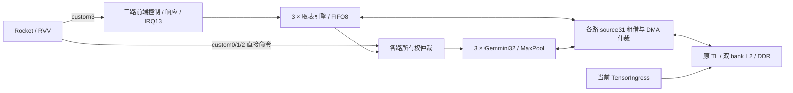

# 三路自主命令前端

本轮只同步硬件。供体为 `sixteen_camera_3x32_100mhz_memory_parallel_v3_maxpool_timing_s1_2026-10-14`，用户指定的 `impl_frontend/top_wrapper.bit` 已于 2026-10-15 08:48 生成；综合 Tcl 确认使用 FrontendConfig 的前端 RTL。
供体最终 postroute_physopt 时序报告 WNS=-1.990 ns、TNS=-35843.008 ns，约束未满足。该 bit 的生成成功不代表时序签核通过，也不是本仓库加入 TensorIngress 后的实现结果。

原生 Scala 位于 `hw/soc/source/command_frontend/scala/`，接入的 LazyRoCC、RocketTile、Configs.scala 位于其 `integration/`。生成器将这些有效覆盖安装到独立 Chipyard 工作区，与当前 TensorIngress Config 组合；使用 SBT/Chisel/firtool 正常生成，再运行原有 URAM/BRAM 推断处理。生产前端无 SV BlackBox，也不手改生成 RTL。

前端 lane 0/1/2 对应 custom0/1/2，既有逻辑 worker 2/1/0；所有 CSR 和 SLR 放置保持原对应。custom3 funct[6:5] 选择 lane，值 3 为全局；funct[4:0] 是操作码。

| 操作码 | 作用 |
| --- | --- |
| 0 / 1 | 设置命令表地址与数量 / 帧基址与超时 |
| 2 / 3 | 启动 / 查询状态与进度 |
| 4 / 5 | 以匹配标签 RESUME / ACK 完成或异常 |
| 6 / 7 / 8 | 设置启动周期 / ARM / 取消 ARM |
| 全局 7 | ARM_MASK，同时预备多路，按各路设定周期启动 |

命令记录为四个 64 位字 `control, rs1, rs2, reserved`，共 32 字节。control[7:0] 为 RAW=0、DRAIN=1、HOST=2；RAW funct 位于 [14:8]，[16]/[17] 指定 rs1/rs2 加帧基址，其余保留位为零。表按数量结束，无 END。
支持 funct 0..21 和 23..26（包括 SiLU LUT）。时钟门控 22 和返回寄存器的诊断命令只能由 CPU 直接提交。
表地址 32 字节对齐，数量 1..65535；描述符及重定位物理地址范围为 `0x80000000..0xffffffff`。原 Gemmini 数据 DMA 仍保留 33 位地址、64 个 source 和协商的 sink 位宽。

每路有 FIFO8、一笔取表读在途，在本路 DMA 空闲的 source31 上租借标识；收到最后一个响应 beat 后释放。没有增加全局 TL master，也不永久占用 DMA 标识。内存仲裁保持多拍锁定、反压与零延迟响应语义。

DRAIN 等本路计算及写回完成后继续；HOST 在完成后暂停，CPU 可处理 RVV 工作、发布写入，再以正确标签 RESUME；其他 lane 继续运行。DONE/HOST/FAULT 按 lane 独立记录，中断电平汇总，软件需分别处理 pending；ACK 一路不会清除其他路事件。
前端拥有的 lane 不允许 CPU 同时直接发令，否则可能堵住共享 RoCC 队列。CPU fence 仅等待 CPU 命令/响应与未被前端拥有的计算；自主任务完成必须查询 HOST/DONE。超时进入错误排空，Gemmini 永久 busy 时不释放所有权，不能把超时视为安全中止。

后续软件需按 M-mode 裸机约定发布 CPU/RVV 写入，在前端执行期间保持命令表不变，并实现新的 lane、所有权、HOST/RESUME 与完成协议。本轮未修改 `sw/`、模型生成器、权重或调度器；固件适配状态由 `current.json` 明确记为 `pending_frontend_port`。
