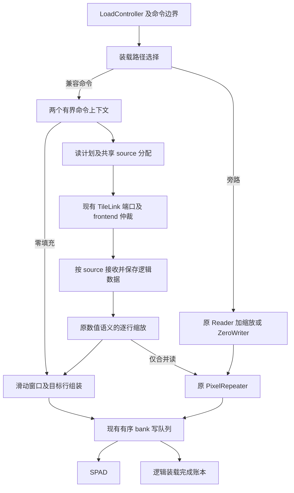

# Gemmini 短请求合并与 SPAD 行组装实现方案

日期：2026-10-17。原三模式候选已生成 bitstream，完整芯片 setup 时序未通过；原板测结果见验证记录。新增第四模式及每项 12 帧短测仅执行源码单元和软件离线验证，见第 16 节；复用原三模式候选的小 ELF 已完成 OPS=1／32 板测，见第 17 节。未生成新比特流。

本方案优化 Gemmini 从主存装载到 scratchpad（SPAD）的路径。硬件根据原有 `mvin` 命令的长度、步长和重复参数，将相邻短读整理为较少的 TileLink 事务，并直接组装目标 SPAD 行，减少 `PixelRepeater` 逐次生成的零碎写入。实现不识别模型名称或层号，不要求输入执行 S2D，也不改变软件可见的张量布局、权重或现有计算指令编码；另增带能力查询的诊断控制入口，用于运行时选择装载模式。

首版采用单个 load 命令内的有界组装，优先覆盖窄通道输入和权重。完整行及不兼容模式使用现有路径。验收分别检查数值、事务数、SPAD 写入量、端到端周期和全芯片时序；首层 S2D 的 4.2 倍结果作为动机，不作为本方案的性能承诺。

考虑到一次 bitstream 构建约需八小时，本次候选只生成一版包含全部三种模式的 bitstream。上板后由同一诊断 ELF 在安全空闲边界切换模式完成对比，不为各模式分别生成硬件。复位默认 `legacy`，旧软件不主动切换时继续使用原路径。

## 1 依据与适用场景

### 1.1 已有板测

[首层实验记录](../optimization/first-layer-s2d.md)及[归档 UART](../../tests/data/first_layer_s2d/board_20261016.uart.txt)通过严格分析器检查。每项为四轮累计 12 帧，100MHz，warmup 排除：

| 方案 | 串行周期 | 三路并行周期 | 相对原始串行收益 | 相对原始并行收益 |
| --- | ---: | ---: | ---: | ---: |
| reference | 28,628,290 | 10,099,130 | 1.0000× | 1.0000× |
| prepacked | 6,875,833 | 2,410,250 | 4.1636× | 4.1901× |
| rvv_online | 27,052,169 | 22,695,223 | 1.0583× | 0.4450× |

`prepacked` 不计输入重排时间。日志没有 bitstream 身份，不能将这些结果归属于当前四 bank L2 或本方案候选硬件。UART SHA256 为 `66c5065fa6cc00eb33aba16c8593a2df3949daea1ca13b1806217fe0811a02ff`。

原始首层每帧包含 352,775 个非 padding 输入行请求，`pixel_repeats=6`；按当前串行展开机制，仅这些请求就需要至少 2,116,650 个重复处理周期。这是按冻结计划和源码推导的工作量，不是独立测得的 stall 周期。联合优化必须改变展开机制，才能消除这部分工作。

`load_req_wait` 是请求接口反压，不能直接解释为 bank 冲突；不同计数器、不同 lane 的等待可能重叠，不能相加作为可回收周期。

### 1.2 其他层也存在装载机会

[冻结计划](../../sw/models/yolov5nu/frozen/frontend_v33/fixed_plans.json)包含 58 个普通卷积阶段，其 SHA256 为 `f5e859051dd9e095dfa0dcce770b1eec2f738c9d9be99b3cc72cf25d39a1381d`。

| 阶段 | 已确认的模式 | 首版预期覆盖 |
| --- | --- | --- |
| 0 | 输入 3B，物理步长 3B，重复 6 次 | 合并读和行组装 |
| 2、10 | 输入 16B，物理步长 16B，重复 2 次 | 合并读和行组装 |
| 8 | 输入 16B，物理步长 16B，重复 1 次 | 主要减少读事务 |
| 4、5 | 权重行 16B，权重步长 16B | 合并权重读 |
| 59、132 | 输入通道分块 24、104，物理步长 128B | 短行不连续，首版通常旁路 |
| 80 通道及其他尾块 | 可出现 16B 等尾部装载 | 由真实命令长度、地址间距和请求顺序决定 |

表中是静态机会，不是逐层性能结论。通道数不能直接当作 DMA 请求长度；必须继续展开 `LoopConvLdInput`、`LoopConvLdWeight` 和 `LoadController`。保留现有权重复用，禁止通过重复装载制造合并命中率。

## 2 当前路径与改动边界

当前数据路径为：

```text
LoopConv 或普通 mvin
  → LoadController 按行生成请求
  → Scratchpad read_issue_q
  → StreamReaderCore / XactTracker / BeatMerger
  → VectorScalarMultiplier
  → PixelRepeater
  → mvinWriteBuffer
  → OrderedBankWrites
  → ScratchpadBank
```

padding 使用 `ZeroWriter` 和独立的 `PixelRepeater`，随后进入相同的 bank 写仲裁。现有完成事件可以在写入进入 `OrderedBankWrites` 时产生，因为该队列仍将未落 SRAM 的地址暴露给读冲突检查。

当前实验版 [DmaReadCoalescer](../../hw/soc/source/shell/npu100_video/src/main/scala/gemmini/DmaReadCoalescer.scala)只合并两个完整的 32B 行，要求 `pixel_repeats=1`。它不覆盖本方案关注的 3B、16B 重复装载。旧 DMA v2 同时改变了预取、缓冲和仲裁，[实验记录](../../hw/soc/source/shell/npu100_video/EXPERIMENTAL_MEMORY_DMA.txt)未证明整网收益，不能整套启用后作为本方案的 A/B 结果。

本次优化对象为主存到 SPAD 的装载，包括输入、权重和适用的零填充。`mvout` 的主存短写、ACC 累加、计算阵列、L2 几何、DDR 宽度及仲裁策略不属于首版改动。

## 3 首版功能选择

### 3.1 同一 bitstream 内的三种运行时模式

候选 elaboration 启用运行时装载功能，保留原路径、短读合并和行组装所需逻辑。`dma_load_mode` 为每 lane 的运行时状态，复位为 `0 / legacy`，不是生成三份硬件的 elaboration 选择：

| 编码 | `dma_load_mode` | 读侧 | 写侧 | 用途 |
| ---: | --- | --- | --- | --- |
| 0 | `legacy` | 原路径 | 原路径 | 同版本基线 |
| 1 | `read_coalesced` | 兼容短行合并读取 | 恢复逻辑行，继续原缩放和重复写入 | 隔离读侧收益 |
| 2 | `read_assembled` | 兼容短行合并读取 | 直接组装目标行 | 联合优化 |

编码 3 保留，写入时拒绝且不改变当前模式。运行时装载功能与旧 `dma_read_coalescing` 禁止同时启用，elaboration 时检查。三种模式使用同一份 RTL、bitstream、诊断 ELF 和模型计划，保持相同的频率、在途请求额度、bank 仲裁及外围配置。Reader、source 池、缩放器和写队列复用，不为三种模式各复制一套。

### 3.2 模式控制与安全切换

诊断控制复用自主前端 custom3 的每 lane 编码 `(lane<<5)|op`。新增 `op=9` 设置模式，`rs1=0/1/2`；返回 `0=成功、1=busy、2=非法模式、3=不支持、4=fault`。查询仍使用既有 `op=3`，`rs1=7/8/9/10` 分别读取能力、当前模式、拒绝次数和 64 位构建标识。能力值 `0x00010007` 表示控制版本 1 和三种模式。旧硬件查询不匹配时，诊断程序失败退出，不输出三模式对比；已有有效编码与 load/config 语义保持不变。

模式设置只在该 lane 的自主前端已释放所有权、没有待执行描述符或 HOST 操作，且 Gemmini 全部空闲并排空时接受。排空范围包括命令/ROB/load tracker、原 Reader 和在途 TL 事务、组上下文、缩放与重复流水、零写、组装窗口、输出及 completion FIFO、所有 bank 有序写队列和相关写响应。不能仅凭 frontend DONE 或单个 `busy` 信号判断。控制写入与新命令提交必须互斥仲裁，禁止同周期接受后又按旧模式启动命令的竞争。

不满足条件时返回明确的 busy、fault 或非法模式结果，保持原模式；不排队延迟生效，不隐式取消、flush 或丢弃在途数据。sticky fault 期间禁止切换，恢复仍按第 8.4 节协调复位。软件先停止提交并等待排空，设置后核对成功状态和模式回读，再发布下一批工作。控制访问应能在 lane 时钟门控时完成或唤醒控制逻辑。

运行时模式在命令第一行握手时快照，并用于本命令的全部处理；后续不重新读取可变控制状态。软件三路对比时先停止所有 lane 并排空，逐路设置和回读，确认三路一致后才开始测量；首版不要求跨 lane 原子写。模式切换、回读、计数器清零和 warmup 均放在正式计时窗口之外，UART 记录每 lane 的实际生效模式。

### 3.3 资格条件

设 SPAD 行宽为 `W` 字节，原命令每行有效字节数为 `C`，实际读取行数为 `N`，横向重复次数为 `P`。当前硬件 `W=32`，`N<=32`。

新路径的共同条件为：

- INT8 写入 SPAD，`!is_acc && !accumulate && !has_acc_bitwidth`。
- `1 <= C < W`，`1 <= N <= block_rows`，`1 <= P` 且 `P*C <= W`。
- `repeats=0`，即不混入 stride 为零的广播装载语义。
- 同一命令的缩放、状态、长度、重复次数和目标映射保持一致。
- 目标地址递增、不绕回，并能按原 `floorSub` 规则处理半区下溢；跨半区的特殊范围旁路。
- 非零输入使用当前物理地址模式，读范围属于支持相应 Get 大小的普通主存。MMIO、TLB 翻译和无法证明合法的扩大读取使用原路径。

读合并另外要求相邻逻辑行的物理地址连续，即 `stride_bytes=C`。行组装本身只依赖逻辑行和 SPAD 映射：在 `read_assembled` 模式下，`P>1` 的非连续输入也可使用原粒度读取，再进行组装。

`P=1` 且读侧不可合并时直接旁路。`C>=W`、ACC、广播及不兼容语义也旁路。宽行内部的短尾块不在首版拆出来重新优化，以保留原 `block_stride` 和完成规则。

padding 零命令在 `read_assembled` 下可进入组装路径，前提是上述长度和目标条件成立。真实零填充不发 TL 请求、不经过浮点缩放，与原 `ZeroWriter` 一致。`read_coalesced` 的零填充仍走原路径。

## 4 微架构



首版使用两个命令上下文，每个最多保存 `block_rows*W` 字节逻辑输入。DIM32 时数据容量上限为每上下文 1KiB，每 lane 两个上下文；实际资源还包括元数据、窗口和队列，须综合确认。缓冲的单位是一个最多 32 行的 `mvin`，不是整个卷积 tile 或图像。

每个上下文按以下阶段推进：

```text
FREE → COLLECT → FETCH → EMIT → TAIL → RETIRE → FREE
```

- `COLLECT` 接收本命令的全部行描述符；分配时预留整个命令的存储，保证余下行可被接收。
- `FETCH` 将返回数据放入本命令的逻辑数据缓冲。零命令直接完成此阶段。
- `EMIT` 按原逻辑行顺序读取数据、缩放并生成目标写入。
- `TAIL` 排出窗口中余下的有效字节；`P=1` 时无需额外尾部移位。
- `RETIRE` 等待本命令的写入及完成事件满足第 8 节条件，然后释放上下文。

两个上下文允许后一命令的收集和读取与前一命令的输出重叠。读返回可乱序，目标写入按上下文接受顺序提交。首版在完整命令数据返回后开始输出，优先保证有限存储和可验证的顺序；后续只有实测显示必要时才增加按行提前输出。

同一运行时模式下，优化命令与不兼容旁路命令之间切换时，先排空较老装载的未提交写入与完成事件，再启动新路径，避免引入跨路径 WAW 反转。连续旁路命令沿用原机制；连续优化命令允许两个上下文流水。该路径切换成本必须单独计数，并计入工作负载耗时。它不同于第 3.2 节中计时外的软件模式切换。

## 5 内部接口与资源身份

### 5.1 命令边界

在 `ScratchpadMemReadRequest` 的内部接口中增加下列信息；字段名为实现建议，不改变已有 RoCC 或 frontend 命令格式；第 3.2 节的诊断控制扩展单独记录版本和能力：

| 字段 | 来源和作用 |
| --- | --- |
| `cmd_first` | 第一个被接受的行请求 |
| `cmd_last` | 最后一个实际行请求 |
| `cmd_rows` | `actual_rows_read`，用于预留容量和结束检查 |
| `row_index` | 本命令中的逻辑行序号 |
| `cmd_stride_bytes` | 本次命令快照中的主存步长 |
| `cmd_mode` | 第一行握手时的运行时模式快照，后续行及返回处理沿用 |

沿用已有 `cmd_id`、`cols`、`laddr`、`scale`、`pixel_repeats`、`block_stride`、`status` 和 `all_zeros`。元数据仅在握手时生效；第一行反压时保持稳定。不能在返回时重新读取已经被下一条 config 改写的寄存器。

路径在第一行确定，此命令后续行必须进入同一上下文。后续元数据不一致属于内部协议错误，不能在接收一半后静默切换到旁路。

### 5.2 三种身份必须分开

| 身份 | 表示什么 | 释放条件 |
| --- | --- | --- |
| `cmd_id` | 原 load 命令和 ROB 依赖 | 原有效字节全部完成 |
| `group_id` | 新上下文及其输入、窗口、待提交写入 | 原命令账本已安全结束，所有内部引用消失 |
| TL `source` | 一次实际总线事务 | 最后一拍及返回元数据已被可靠接收 |

`cmd_id` 可被现有 tracker 复用，不能当作永久组号。先清理全部旧引用，再归还最后一笔 completion；不得让延迟返回写进新上下文。组提交顺序使用有界 FIFO 顺序，不依赖可能绕回的无界编号比较。

### 5.3 读事务与返回接口

扩展 Reader 内部事务类型，至少区分 `legacy_row` 和 `group_fragment`。新事务保存 `group_id`、逻辑缓冲偏移、有效字节数、返回移位和目标片段身份。连续输入按逻辑字节偏移存储；非连续输入按行及行内偏移存储。

复用现有 TL 端口、source 分配和最大在途额度。每个发出的事务必须预留返回存储，不能等 D 返回后才争取容量。前端仍通过原 `CommandFrontendMemoryMux` 租借 source31，不新增 TL master，也不永久保留或绕过 source31。

现有 `XactTrackerEntry` 面向一条普通行响应；不能仅扩大 `len` 就把多个目的行塞入它。新类型必须显式经过返回分流，普通请求继续使用 `BeatMerger`，组请求进入片段接收逻辑，并在寄存边界后更新组缓冲。

现有 `StreamReadResponse.bytes_read` 只有 8 位，不适合直接承载整个命令的字节数。组 completion 使用独立、足够宽的内部接口，至少容纳 `block_rows*W`；当前 DIM32 最大预留 1,024B，需要包含该值的 11 位计数。最终 `ScratchpadReadMemIO` 的 `bytesRead` 为 16 位，归还到 `DMACommandTracker` 时保持原单位。

## 6 读合并算法

### 6.1 连续短行

收齐一个命令后，其有效输入区间为：

```text
[first_vaddr, first_vaddr + N*C)
```

在该区间内逐段生成合法的 32B 或 64B 对齐 Get，复用现有读包选择规则，优先减少事务。单个 Get 不跨 64B line，扩大读取仍必须落在合法普通主存区域。4KiB、地址溢出及物理区域边界同时检查。

不把整个 `N*C` 直接编码成一个旧 `StreamReadRequest`；旧 Reader 的行进度和目的地址计算是按原行语义设计的。规划器应发出不超过 `dma_maxbytes` 的组片段，每个片段记录它覆盖的逻辑字节区间。

不同 source 可以乱序返回。按事务元数据写入各自缓冲偏移，累计有效字节覆盖，只有所有需要的字节都到齐后才进入输出阶段。不能按 D 返回顺序拼接数据。

### 6.2 非连续输入与旁路

`P>1` 且允许行组装的非连续命令按原行地址分别读取，仍可减少重复写入。其读侧不宣称合并收益，也不因为跨越空洞而无条件读取更大范围。

其他非连续短行首版旁路。未来可根据同一命令内的 line 重叠增加合并，但需证明事务数、额外读字节和延迟的取舍。首版不实现跨命令行缓存，避免引入新的持久数据一致性规则。

### 6.3 仅合并读模式

组数据返回后，恢复 `N` 个原逻辑行，逐行携带原地址、`C`、低 `C` 字节 mask、缩放、重复次数和 `cmd_id`，进入原缩放和 `PixelRepeater`。

一个逻辑行即使跨过两个总线事务，也只在它的数据完整后输出。每行完成归还 `C` 个有效字节；整命令仍为 `N*C`。此模式保持重复展开，作为联合模式的对照。

## 7 目标行组装算法

### 7.1 必须复现的映射

对一组长度固定、目标递增的行，令缩放后的第 `i` 行为 `x[i]`，目标起始 SPAD 地址为 `a`。原 `PixelRepeater` 对每个 `k` 执行：

```text
目标地址 = a + i - k
字节偏移 = k*C
写入数据 = x[i] 的有效 C 字节
k = P-1, P-2, ..., 0
```

目标地址低于本命令对应半区下界 `F` 的写入被丢弃，与原 `floorSub` 下溢处理一致；不是将它们集中写到 `F`。新逻辑不能借组装覆盖未被原 mask 选中的字节。

### 7.2 滑动窗口

因为 `P*C<=W`，可用一个 `W` 字节窗口和对应字节 mask 替代每个输入产生 `P` 个写 token。下列伪代码描述状态语义；状态推进必须受下游接收能力控制：

```text
window_data = 0
window_mask = 0

for t in 0 .. N+P-2:
    if t < N:
        sample = 原缩放语义得到的 x[t]，仅保留低 C 字节，其余清零
        sample_mask = low_C_bytes
    else:
        sample = 0
        sample_mask = 0

    window_data = (window_data >> (8*C)) | (sample << (8*C*(P-1)))
    window_mask = (window_mask >> C) | (sample_mask << (C*(P-1)))
    target = a + t - (P-1)

    if target >= F and window_mask != 0:
        emit(target, window_data, window_mask)
```

尾部的无效 sample 用于排空窗口，mask 为零；真实 padding sample 的数据为零，但其有效字节 mask 非零。这两个概念不得混淆。

`target` 的减法使用扩展位宽和显式下溢判断，不能先截断成无符号 SPAD 地址再比较。样本高位必须清零，避免无效数据在窗口移位后与后续有效样本按位 OR，污染有效字节。

此算法每推进一步最多输出一个目标行，消除了先生成 `P` 次重复写再合并的串行过程。需要保证常规输出阶段可每周期推进一个逻辑样本或一个尾部步骤，而不是内部仍用 `P` 周期更新窗口。

### 7.3 操作数例子

以下均为 `N=32`、不发生下溢、完整处理一个命令，包含组尾部分 mask 行。原次数按完整逻辑行展开计算；旧路径的总线边界分片还可能增加实际重复处理次数：

| `C` | `P` | 原重复处理次数 | 组装后的目标写入数 |
| ---: | ---: | ---: | ---: |
| 3 | 6 | 192 | 37 |
| 12 | 2 | 64 | 33 |
| 16 | 2 | 64 | 33 |
| 16 | 1 | 32 | 32 |

`N+P-1` 只用于这些资格条件下的内部组装，不是任意 DMA 的公式。命令边界分别写入部分 mask，允许相邻命令再次写到同一个目标行；首版不为消除这几次边界写而延迟前一命令完成。

### 7.4 缩放与存储实现

复用 `VectorScalarMultiplier` 的数值实现，包括 FP16 舍入和饱和。每个真实输入样本先按原 scale 得到结果，再进入窗口，不重新定义量化。真实零填充绕过缩放。

逻辑输入缓冲可按 32B 分 bank 保存，用递增字节指针提取 `C` 字节。跨 word 时最多读取两个相邻 word，采用分 bank 和寄存后的对齐选择；避免在关键路径上使用除以动态 `C` 的运算或大范围多端口选择。窗口移位、地址形成和最终写队列之间保留寄存边界。

## 8 完成语义与前进保证

### 8.1 命令完成条件

`read_assembled` 只在以下条件全部满足时产生一次组完成：

1. 所有 `N` 个逻辑行都已接收，原始有效字节总数为 `N*C`。
2. 所有已发出的 TL 请求都已返回，原数据和缩放流水不再持有该组的引用。
3. 窗口尾部已排空；所有非空 mask 的目标写入均已被现有 `OrderedBankWrites` 接受。
4. 没有该组的返回错误，也没有尚未入队的输出 token。

完成回报为原 `cmd_id` 和 `N*C`。下溢丢弃的目标写、重复写和额外取回的 cache-line 字节不改变这笔逻辑账本。零命令也归还原 `N*C`，即使没有 TL 事务。

`read_coalesced` 继续使用原逻辑行的完成事件，累计到 `N*C` 后释放组；不能再追加一次组完成。建立断言：每组总归还字节恰好为 `N*C`，不得提前、重复或丢失。

现有 DMA read completion 接口是 `Valid`，不能反压。实现将组完成标记、`cmd_id` 和 `N*C` 随最终写 token 保存在非穿透的 `mvinWriteBuffer` 中；最终写进入 `OrderedBankWrites` 时才归还字节。组完成复用原 mvin 的完成位置，不另增加一个未经仲裁的 `Valid` 源。原 mvin、ACC、零写仍按原优先级每周期最多归还一笔，零写末 token 必须避让已有完成；不能简单将多个 valid 相或。

### 8.2 读写依赖

组装缓冲中的数据不能被当作已写入 SPAD。命令在所有组装写进入有序队列之前保持未完成，使 RS 继续阻止依赖该命令的计算。写入队列后的地址继续由 `readHazard` 保护，直到 SRAM 写入被接受。

保持原有 EX、DMA、零写的顺序约束和仲裁优先级。新输出应接入现有 bank 写入口，不绕过 `OrderedBankWrites`，也不为了增加命中率跨过一个较老的冲突写。组间按接受顺序提交，组内只能合并已证明属于同一目标行、有效字节语义一致的更新。

新增内部 `pending` 状态覆盖命令上下文、TL 返回、缩放、窗口、输出 token 和完成 FIFO。它必须进入 `Scratchpad.busy` 及最终 Gemmini busy。为有序写队列增加可靠的非空观测，使候选硬件三种运行时模式下的 DRAIN、HOST、DONE、模式切换和时钟门控也覆盖仍未提交到 SRAM 的 DMA 写；不能仅检查 EX 写回标志。

### 8.3 有界排空

首版以一个命令为组，接收第一行时预留剩余全部行的空间。既不等待下一条命令填满窗口，也不等待 mask 达到 32B 全有效。最后一行到达后，有限的 `P-1` 个尾部步骤即可结束组装。

容量满时只反压尚未接收的新命令；不能撤销已接收的行。读侧发请求前预留返回位置，提交端为组尾和完成事件保留前进通路。两个上下文和原有两个 load tracker 槽之间不得形成“等新命令才能完成旧命令”的环。

输出 `valid && !ready` 时，地址、数据、mask、组号保持稳定。尾部计数器仅在输出被接收或该步确定无写入时推进。

### 8.4 错误与复位

新增返回路径检查 TL `denied`、`corrupt` 及不匹配的事务身份。出错组不得报告成功完成；停止接收新的优化命令，继续接收并排空已经发出的响应，保留 sticky fault。

当前物理地址配置的 `io.interrupt` 主要来自可选 TLB，不能假设它已经覆盖新的 DMA 错误。实现须补上组错误到 Gemmini fault、再到自主前端 `gemmini_fault` 的内部连接。首版采用故障后需协调复位的策略，busy 和故障保持，不复用未安全结束的命令身份；不得通过提前返回 completion 制造 DONE。

frontend timeout 不是取消在途事务。现有 `flush` 的 TLB 语义也不是清空组缓冲的许可。局部丢弃 tag 后让旧 D 响应继续到达会造成身份混淆；恢复必须使用覆盖相关事务端点的复位流程。测试分别验证正常排空和故障保持。

## 9 配置与源码改动

已新增 elaboration 参数及默认值：

| 参数 | 默认值 | 约束 |
| --- | --- | --- |
| `dma_load_runtime_enable` | `false` | 生产默认保留原实现；本次单 bitstream 候选设为 `true`，同时保留三种运行时模式 |
| `dma_load_group_entries` | 2 | 首版固定两个上下文，独立于 TL source 数量 |
| `dma_load_group_rows` | `block_rows` | 首版要求等于合法命令最大实际行数，当前为 32 |
| `dma_load_max_pixel_repeats` | `block_cols` | 以 `P*C<=W` 限制实际窗口；可较小并旁路其他值 |

`dma_load_mode` 不属于上述 elaboration 参数，它是复位值固定为 `legacy` 的每 lane 控制状态。诊断控制编码见第 3.2 节，软件入口为 `gf_set_dma_load_mode()`。关闭 `dma_load_runtime_enable` 时不实例化新装载数据通路，也不宣称支持优化模式。

所有新增容量都按参数计算。首版在本项目的 DIM32、INT8、256-bit DMA、64B 最大请求配置上验收；其他配置通过合法性检查或关闭运行时装载功能。

以下路径均相对仓库根，标记“新增”的文件为本次新增源码：

| 文件或目录 | 实现工作 |
| --- | --- |
| `hw/soc/source/shell/npu100_video/src/main/scala/gemmini/GemminiConfigs.scala` | 新参数、资格约束和旧实验互斥 |
| 同目录 `LoadController.scala` | 命令边界、行序号、步长快照；保持逻辑字节账本 |
| 同目录 `Scratchpad.scala` | 路径选择、优化零写、缩放接入、bank 提交及 completion 仲裁 |
| 同目录 `DmaLoadGroup.scala`，新增 | 两个命令上下文、路径切换和有界状态机 |
| 同目录 `DmaLoadReadPlanner.scala`，新增 | 连续区间规划及非连续原粒度读取 |
| 同目录 `DmaLoadRowAssembler.scala`，新增 | 缩放后窗口、mask、半区下溢和尾部排空 |
| 同目录 `DMA.scala`、`XactTracker.scala` | 共享 source、组片段元数据、返回分流和错误连接 |
| 同目录 `BeatMerger.scala`、`PixelRepeater.scala` | 保留旁路及读合并模式语义；组装模式避开串行重复展开 |
| 同目录 `TimingClosure.scala`、`Controller.scala` | 写队列非空观测、busy、fault、运行时模式及安全切换、寄存边界 |
| 同目录 `CounterFile.scala` | 增量增加观测事件，不重编号已有事件 |
| 两份有效 `Configs.scala` 及 SoC 构建脚本 | 启用包含全部模式的单一候选，记录容量、复位模式和来源 |
| `command_frontend` 控制接口及对应软件头文件 | 诊断能力查询、每 lane 模式设置/回读、空闲与所有权互斥检查，保留现有命令兼容性 |
| `tests/model/dma_load/`，新增 | 独立的装载语义参考模型及参数化向量 |
| `tests/rtl/scala/DmaLoadTest.scala`、候选 runner，新增 | 真正的新 Reader、缩放、组装、完成及 SPAD 集成测试 |
| `sw/benchmarks/frontend/` | 同一 ELF 内安全切换三模式、回读校验、逐层计数和完整结果校验 |

配置覆盖有一个必须处理的细节：生成器先复制 `shell/npu100_video/fpga/.../Configs.scala`，随后由 `command_frontend/integration/fpga/.../Configs.scala` 覆盖。应以最终有效源为准，同步基础配置和 frontend 覆盖，并由 `validate_workspace_sources` 检查；只修改前一份不会保证候选硬件生效。

## 10 生成和候选身份

本次候选使用一个独立 Chipyard 工作区、一份候选 RTL 和一个 bitstream 构建目录，与唯一生产 SoC 导出隔离。构建脚本已增加 `--dma-load-runtime`，要求配合 `--l2-banks 2 --no-export`，在同一次 elaboration 中生成全部三种模式。采用未扩容的 S1 L2：512 KiB、2 bank、512 set/bank、8 way、64B line，MPV3 统计 ABI 1.1；本次不使用生产导出的 1 MiB/4 bank 配置。

实验目录统一放在 `build/experiments/dma_load/<run>/`，生成记录、RTL 和 bitstream 为三模式共用；仿真日志和板测报告按模式、lane、轮次分目录保存。三模式验收必须使用同一份 RTL 和 bitstream 哈希，测试 runner 的 `--mode` 仅负责启动后设置运行时状态，不触发重新生成硬件。正式综合/实现前先在这份候选 RTL 上完成三模式回归及模式切换验证，再构建一次供上板对比的 bitstream。

新增参数进入实际 Scala 配置和源码验证规则，不能只写到日志而没有接入硬件。候选来源至少记录：

- 仓库提交及工作区差异摘要、最终有效 Scala 哈希。
- `dma_load_runtime_enable`、支持模式位图、控制版本、复位模式、容量参数、DMA/TL 宽度及实际 source 额度。
- frontend ABI、L2 bank 数、容量、频率及相关 feature 配置。
- 生成 RTL、bitstream、ELF、命令计划和输入数据的 SHA256。
- 测试实际使用的 RTL 绝对路径、用例、seed 和工具版本。
- 硬件可读构建标识，以及每个测量窗口前成功设置并回读的各 lane 模式；构建标识与归档 bitstream 哈希通过生成记录对应。

不手改生成的 `.sv` 实现功能。新模块通过现有 Scala/Chisel 生成链进入候选 RTL，并继续执行项目已有 RAM 推断处理和结构检查。

`tests/rtl/command_frontend/test_real_gemmini.py` 和首层 RTL 入口已支持 `--rtl`、`--output`、`--dma-load-mode all`。私有候选必须显式指定路径，逐项核验 `GENERATION_CONTEXT.json` 的 RTL 哈希；缺省生产路径不能用于本功能验收。三模式通过真实 frontend 控制入口设置及回读，同一仿真中不在模式之间复位。

`make firmware` 的实时 Runtime 适配状态与本优化无关；本方案板测使用独立 frontend benchmark，不将构建独立 ELF 等同于完成实时 Runtime 适配。

## 11 观测与结果解释

按 lane、模式和测量窗口记录以下计数。旧计数器编号保持稳定，新事件追加，并在诊断日志输出 schema、硬件身份、控制版本、支持模式位图和各 lane 实际模式。请求模式与回读模式不符、切换未成功或能力不足时判定本轮失败，不继续测量。需要多组计数器采样时，使用同一输入和计划重复独立测量，不将不同窗口的等待直接相加。

| 指标 | 定义或用途 |
| --- | --- |
| `load_logical_rows` | 原 load 行握手数，零填充另计 |
| `load_logical_bytes` | 原有效字节数，不含重复写和过读 |
| `optimized_groups` | 接受的新路径命令数 |
| `bypass_groups_by_reason` | 完整行、非连续、ACC、广播、地址或其他不兼容原因 |
| `tl_get_32`、`tl_get_64` | 实际 A 握手的读取事务数 |
| `tl_read_bytes` | 实际 D 返回字节，含扩大读取 |
| `reference_write_updates` | 同一逻辑输入按原映射需要的更新次数，排除下溢 |
| `assembled_write_tokens` | 行组装产生并被接收的目标写 token |
| `spad_bank_write_fires` | SRAM 接受的真实 DMA 写，零写分类记录 |
| `group_collect_cycles`、`group_fetch_wait_cycles` | 收集和返回等待，不合并为可回收预算 |
| `group_output_stall_cycles` | 组装输出被 bank 或队列反压 |
| `path_switch_wait_cycles` | 优化和原路径切换的排空成本 |
| `mode_switch_rejects` | 运行时控制因 busy、fault 或非法值拒绝的次数；与命令内路径切换分开 |
| `group_occupancy_peak`、`return_occupancy_peak` | 容量是否限制吞吐 |
| `completion_wait_cycles` | 带完成标记的 token 等待周期，包括 bank 反压，不是独占的完成仲裁耗时 |
| `faults`、`tail_flushes` | 错误和尾部排空行为 |

真实 SRAM 写统计应对并行 bank 握手做求和，不能只对所有 bank 的 fire 做 OR。所有模式都记录相同定义的基础指标，避免只在优化模式里有可用分母。

新增 Gemmini external counter 编号为 8～34；原 0～7 不重编号。8/9/10 为非零逻辑行、有效字节（含零）和零行，11 为优化命令；12～17 为完整行、非连续、ACC、广播、地址及其他旁路；18/19 为实际 Get32/Get64；20/21/22/23 为原映射更新、组装 token、真实 DMA SRAM 写和其中的零写；24～30 为 collect、fetch、output、路径切换、组峰值、返回队列峰值及完成等待；31/32 为 fault 和尾部步骤；33 为实际 D beat 字节；34 为关闭优化的旁路。计数器均为 32 位，长窗口须留意回绕。

旧 external ID4 保留历史口径：每个 D beat 都累计整个事务大小，64B 两拍会被重复计数。本实验以新增 ID33 的每拍 32B 口径统计实际返回量。frontend 查询 9 的模式设置拒绝数，与 Gemmini external ID9 属于不同命名空间。

ID20 是按原逻辑映射估算的更新次数，不含总线分片额外生成的重复 token；它可以包含 ACC 更新。ID22 只统计真实 SPAD DMA 写，含零写，不含 EX 或 ACC 写。因此应横向比较同工作量下各模式的 ID22，不能将整网 ID20/ID22 直接当成行组装压缩率。等待类计数允许重叠，不能直接相加作为可回收周期预算。

读收益比较同一工作量下的实际 Get 数和返回字节；写收益比较同一目的字节语义下的真实写入量。TL 事务减少不等于 DDR 字节按同一比例减少。最终性能仍由首层、代表层和整网的墙钟周期决定。

## 12 验证矩阵

### 12.1 独立语义参考

参考模型直接按原 `PixelRepeater` 的逐输入、逐重复映射更新带 poison 初值的 SPAD，不使用新窗口算法作为 golden。新模型和 RTL 在命令可见完成后比较全部目标字节及未命中字节；随机插入依赖读取，检查完成之前不会暴露不完整行。

读取语义独立按原二维地址、步长和有效长度计算。既比较最终内存，也核对每个命令只完成一次且有效字节守恒，避免数据正确却提前 completion。

### 12.2 参数与边界

| 类别 | 必测条件 |
| --- | --- |
| 短行宽度 | `C=1,2,3,4,7,8,12,15,16,24,31` |
| 行数 | `N=1,2,3,31,32`，包括只发一个命令后永久停止输入 |
| 重复次数 | 对每个 C 覆盖 `P=1`、合法中间值、`floor(W/C)`；超出优化资格时旁路 |
| 地址 | 起址对 64 的所有余数；跨 32B、64B、4KiB；高物理地址位保真；区域末端 |
| 步长 | 连续 C、带空洞、跨 line，以及广播零步长的原路径 |
| 目标地址 | 两个半区起点及其前后窗口、bank 边界、地址末端和绕回旁路 |
| mask | 3B×6 的 18B 有效窗口、所有部分首尾行、poison 字节保持 |
| 零填充 | 全零命令、零与非零命令交替、连续 padding、部分结果与后续命令重叠 |
| 缩放 | identity、非 identity、正负 INT8 边界、舍入和饱和边界；特殊 FP16 值与原路径对照 |
| 返回 | 多 source 乱序、跨两事务的一个逻辑行、随机 D 延迟和允许的最短响应延迟 |
| 反压 | A、D、缩放、输出、bank 和 completion 持续有限反压及同时握手 |
| 命令身份 | tracker 两槽占满、ID 多次复用、完成与新分配同周期 |
| 模式控制 | 复位默认 legacy、能力及模式回读、三模式两两往返、非法值拒绝、连续设置、三路分别控制及一致性检查 |
| 模式切换边界 | 前端待提交/持有所有权、TL 在途、bank 队列非空、completion 待提交时拒绝；控制写与提交同周期仲裁、时钟门控唤醒、故障期间拒绝；排空后无需复位可成功切换 |
| 混合路径 | 优化输入、完整行、ACC、权重、零写和 EX 写交替，覆盖 RAW/WAW |
| frontend | source31 租借竞争，DRAIN、HOST、DONE、超时及故障排空 |
| 错误 | denied、corrupt、无合法 owner 的响应及协调复位后的新命令 |

原始逻辑写和组装写的顺序不同，等价检查应以命令依赖允许的可见点为准，而不是要求两条路径逐拍输出相同 token。对公平恢复的反压检查有限时间内完成；下游永久不 ready 不属于可承诺前进的条件。

### 12.3 真实计算与多模型参数覆盖

先测试真实 DIM32 的原始首层，再测试 stage 2、10、8、4、5，以及 stage 59、132 的旁路行为。使用相同输入、权重和计划，逐字节比较完整输出。

另生成不绑定 YOLO 的普通 `mvin`、matmul 和卷积用例，覆盖 1、3、8、12、16 等输入通道、不同 kernel/stride、非 identity scale 和非连续地址。它们证明参数覆盖，不冒充其他完整模型的板测结果。

随后执行三路真实 Gemmini 加自主前端、共享内存和视频/Tensor 并发测试。检查共享通路压力下没有丢响应、错误完成或长期饥饿。

## 13 实施顺序与阶段出口

| 阶段 | 交付内容 | 进入下一阶段的条件 |
| --- | --- | --- |
| P0 | 从原 RTL 采集命令和实际行请求；独立参考模型；候选来源与测试路径支持 | stage 0、2、10 的地址、重复数及实际读写量能闭合解释 |
| P1 | 运行时模式控制及能力查询；内部命令边界、资格选择、两上下文、旁路、completion 和 busy 账本 | 安全切换/忙时拒绝验证通过；随机反压及命令 ID 复用下数值和完成均等价 |
| P2 | `read_coalesced` 的 TL 规划、返回映射、错误处理 | 连续短行实际 Get 减少；未改变原重复写语义 |
| P3 | 独立行组装器、缩放和零填充接入 | 参数矩阵通过；3B×6 等用例的写 token 数与独立模型一致 |
| P4 | 真正的 Reader 到 SPAD 集成、前端及三路回归；同一候选 RTL 内三模式与切换测试 | 完整结果、RAW/WAW、DRAIN、source31 和运行时控制测试通过 |
| P5 | 全模式 OOC 检查、一次整机实现、同一诊断 ELF 和单 bitstream 三模式板测 | 全芯片时序满足，收益及完整行回归代价均有实测证据 |

P2 和 P3 通过第 3.1 节的运行时模式区分读事务减少和内部操作减少的贡献；不为此生成独立 bitstream。实现过程中不要同时调 L2、DDR、在途额度、EX 优先级或模型 tiling。

### 13.1 测试入口

当前已有以下入口，可用于基线和受影响功能检查：

```sh
make check
make test-v33
make test-memory-v3
make test-frontend SOC_WORKSPACE=<rebuilt-workspace>
make test-first-layer-s2d-rtl
```

真实计算和首层入口已支持第 10 节的私有候选。`MemoryDmaTest.scala` 保留了旧 DMA v2 的模块测试，它不是本方案的完整回归，不能直接以其 PASS 作为新功能验收。

统一 runner 为 `tests/rtl/run_dma_load_tests.py`，显式接收 `--workspace`、`--rtl`、`--mode` 和 `--output`。`--unit-only` 只报告源码单元通过，不作为候选验收；完整验收使用 `--mode all`，执行源码单元、首层、代表层、参数化 SPAD、故障恢复、内存 mux 的 source31 租借与位宽，以及行请求/Get 闭合检查。`--reuse-integrations <目录>` 可复核该目录下已有的 `first/layers/spad/fault/memory` 结果，仍检查实际候选路径、RTL 闭包和日志哈希，不接受缺项或中途结束的日志。

候选仿真启用生成器的 `RANDOMIZE_REG_INIT`，为 Chisel `RRArbiter` 有意不复位的 `lastGrant` 提供确定的仿真初值。否则四态仿真首次执行非单位缩放会传播 X；此定义仅用于仿真，不改变综合 RTL，也不跳过有效状态检查。

### 13.2 板测方法

只下载一份包含全部模式的候选 bitstream，运行同一版诊断 ELF 和相同计划。诊断程序首先查询硬件构建标识、控制版本及支持模式位图，确认三模式均可用；复位默认 `legacy`。每种模式均执行单 lane 串行和三 lane 并行，warmup 与正式测量分开，并交替模式顺序记录多轮分布。

每次切换按以下步骤执行：

1. 停止全部 lane 的新提交，等待前端释放所有权、Gemmini 空闲以及所有事务、队列排空。
2. 逐 lane 设置目标模式，检查设置结果和实际模式回读；全部一致才继续。
3. 执行该模式的 warmup 并排空；按统一方法准备正式测量的输入、输出初值和缓存压力，再清零计数器，避免采入 warmup 事件。
4. 记录硬件身份及实际模式，对提交到完成的工作负载正式计时，结束后采样计数器并执行完整输出校验；日志输出和数值比较不计入工作负载周期。

模式设置和 warmup 均不计入工作负载周期；工作负载内部的优化/旁路切换成本仍计入。正常模式切换不复位芯片或重新配置 FPGA，不借复位改变缓存状态；故障后按协调复位流程恢复，出错轮次单独保留，不纳入有效性能统计。三模式共用同一份 bitstream/RTL/ELF 哈希，不以三个文件名代替身份核对。

首先比较原始 RGB 首层，随后比较代表层和整网。S2D `prepacked` 只作为另一种布局的参考，不混入“相同工作量”的硬件 A/B 分母。缓存 sweep、计时边界、输入和输出比较方法在三种模式之间保持一致。

所有记录保存完整数值校验结果、原始 UART、逐层和整网周期、计数器快照。视频/Tensor 并发结果单独报告，不能以静态输入实验代替整机表现。

## 14 验收与交付

功能验收要求同一份候选硬件的所有运行时模式与原语义逐字节一致，未选中字节保持原值，完成字节守恒，有限反压后可排空，异常不产生成功完成。两上下文、source31 租借、旁路切换和零填充必须全部进入回归；模式控制覆盖复位默认、成功回读、忙时/故障拒绝以及三模式连续往返，不允许在忙时隐式生效。

结构验收要求读合并用例实际减少 Get，重复写用例实际减少 SPAD 写入；单纯增大 FIFO 或改变等待计数不能作为完成标志。没有合并机会的完整行和旁路工作负载应维持原稳态吞吐，记录新增边界开销；若出现稳定端到端退化，保持默认 `legacy` 并定位原因。

性能验收分别报告首层、其他受益层、旁路层和整网，不要求或预填固定的 4 倍收益。若只有首层获益，需继续核对其他层是否命中资格、事务是否减少以及瓶颈是否已转移，不能据此宣称所有模型加速。

时序验收使用 Vivado 2023.2 的完整布局布线报告，检查 setup、hold、约束和三 lane/各 SLR 资源。OOC 通过或成功生成 bitstream 均不替代全芯片 100MHz 时序满足。重点检查返回路径、窗口移位、模式选择、完成仲裁以及 ready/hazard 反馈，保留现有非穿透寄存边界。运行时模式选择形成的全部合法路径都要满足时序，不能通过固定某个模式的 case analysis 或不当 false path 排除其他模式。

交付物包括 Scala 实现、独立参考模型、参数化 RTL 回归、显式候选构建与测试入口、运行时控制接口和诊断 ELF 源码、完整来源清单、单一候选 bitstream、综合和时序报告、同 bitstream 三模式逐层及整网结果。实验输出放入 `build/experiments/dma_load/<run>/`；通过后的长期验证记录放入 `docs/validation/`。候选复位默认保持 `legacy`；生产是否启用该硬件功能及是否改变默认运行时模式，应以这些证据为依据。

## 15 本次独立候选与操作入口

2026-10-17 更新：板测软件已独立到
[`sw/board_tests/dma_load_512kib_2bank/`](../../sw/board_tests/dma_load_512kib_2bank/README.md)。
该包自带源码、模型、输入、比特流副本、下载与解析入口，修复原整网诊断跨模式／
预热／轮次复用 PPU frame/version 导致状态 2 的问题。后续重测使用独立包的新 ELF；
下方共享 frontend 命令保留为原始实验记录，不包含该编号修复。
本次 bitstream 已于北京时间 2026-10-17 09:43 完成，最终 WNS=-1.467ns，
setup 时序未通过。首层板测通过；编号修复后的整网主测量已完成，联合组装并行
收益为 1.163×，每帧吞吐摊销减少 5.085ms。该次运行在分段诊断时由用户断电，
另有两个正式窗口缺日志，不能记为完整板测 PASS；偶发数值差异仍未关闭。
完整范围与限制见 [验证记录](../validation/gemmini-dma-load-coalescing.md)。

本次使用 `build/experiments/dma_load/512kib_2bank_runtime_20261016/`，候选位于其 `candidate/gen-collateral/`，构建标识为 `2a95a4ca64390235`。该标识由最终有效 Scala 和构建配置计算，frontend 查询 10 可读；并非 bitstream SHA256。生成配置为 `TaihangSoC1Rocket1RVV3Gemmini32x32MemoryParallelV3TensorIngress2BankDmaLoadConfig`，原生产 `hw/soc` 导出及其 1 MiB/4 bank 身份保持独立。

本候选已通过 72 项代表层检查、54 项参数化 SPAD 检查、首层三模式完整输出比较、真实错误恢复、source31/位宽回归及源码单元；逐行请求与 Get 数闭合。三个关键模块的 100MHz OOC setup/hold/pulse 检查通过。完整构建于北京时间 2026-10-16 22:53 启动；结果见 [验证记录](../validation/gemmini-dma-load-coalescing.md)，完整芯片综合和布局布线的状态由 `bitstream/state.json` 持续更新。

完整芯片综合于北京时间 2026-10-16 23:43 通过，`synth_1=100%`，0 errors、0 critical warnings，checkpoint 和输入哈希核验通过。综合交付时曾为 `WAITING_IMPLEMENTATION_LOCK`，随后自动继续实现，最终于 2026-10-17 09:43 生成 bitstream，状态为 `COMPLETE / BITSTREAM_TIMING_UNMET`。

```sh
DMA_RUN=build/experiments/dma_load/512kib_2bank_runtime_20261016
DMA_CONTEXT=$DMA_RUN/candidate/GENERATION_CONTEXT.json

# 构建、审计两份诊断 ELF；各 ELF 内均连续切换三种运行时模式。
make benchmark-dma-load DMA_CONTEXT="$DMA_CONTEXT"
make audit-dma-load DMA_CONTEXT="$DMA_CONTEXT"

# 新目录重跑候选完整功能回归，仿真耗时较长。
make test-dma-load SOC_WORKSPACE=/tmp/sixteen-camera-dma-load-2bank-chipyard \
    DMA_RTL="$DMA_RUN/candidate/gen-collateral" DMA_OUTPUT="$DMA_RUN/recheck"

# 所有功能、OOC 和 ELF 证据通过后，verification.json 才标记 READY_FOR_BITSTREAM。
python3 tools/build/launch_dma_load_bitstream.py --context "$DMA_CONTEXT" \
    --verification "$DMA_RUN/verification.json" --report-dir "$DMA_RUN/bitstream" --check
```

正式完整构建使用同一条 launcher 命令去掉 `--check`，独立创建 `bitstream/project/sixteen_camera.xpr`，依次执行 IP 综合、`synth_1`、`impl_1 -to_step write_bitstream`。综合结果写入 `bitstream/synthesis_result.txt`，监督状态写入 `bitstream/state.json`；综合使用本工程独立锁，实现阶段使用仓库全局构建锁。若已有大工程仍在实现，新候选综合完成后进入 `WAITING_IMPLEMENTATION_LOCK`，锁释放后自动继续布局布线和生成 bitstream。最终文件为 `bitstream/dma_load_512kib_2bank.bit`，SHA256 为 `e930cc0674b0f8756a5e7ecb63aa9d769d824cdca068911d0f180ef3a2efd25c`，最终 WNS=-1.467ns。

上板后先跑首层，再跑整网；下载前只检查不会连接开发板：

```sh
make program-dma-load DMA_CONTEXT="$DMA_CONTEXT" PROGRAM_ARGS="--first --check"
# 完整构建及最终时序检查结束后，显式选择本次候选 bitstream：
make program-bitstream BITSTREAM_FILE="$DMA_RUN/bitstream/dma_load_512kib_2bank.bit"
# 确认已烧写同一候选 bitstream 后下载首层 ELF：
make program-dma-load DMA_CONTEXT="$DMA_CONTEXT" PROGRAM_ARGS="--first"
# 整网 ELF，原始布局及 reference 调度计划：
make program-dma-load DMA_CONTEXT="$DMA_CONTEXT" PROGRAM_ARGS="--model"
python3 sw/benchmarks/frontend/scripts/analyze_dma_load.py <本次UART日志> \
    --context "$DMA_CONTEXT" --output "$DMA_RUN/board_result.json"
```

首层每项四轮共 12 帧，完整比较每窗口 3,686,400B；整网每项四轮共 48 帧，比较最终 PPU 结果并输出 HOST/Head/MPV3 分段诊断。两者均报告同工作量下串行/三路并行周期、并行加速比及相对 legacy 的收益，模式切换和 warmup 不计时。整网结果验证范围是完整图的最终 PPU 输出，不能写成所有中间激活均逐字节验证。已取得首层和整网主测量的收益证据，但整网套件及完整 100MHz 时序尚未通过，仍保持默认 legacy。

跨命令合并、长期保留的 line 缓存、宽行尾块重组、ACC 以及 `mvout` 合并作为后续独立扩展。首版先完成可复用的短行读取、直接行组装及其正确的完成机制。


## 16 SPAD-only 对照与十二帧短测（2026-10-17）

本轮按用户要求仅改代码并完成离线检查，不生成 bitstream、不连接开发板。
新增 mode 3 `spad_assembled`，读请求限制在单个逻辑行内，其他资格、命令收集、
有序返回缓冲、缩放、行组装和完成机制与 mode 2 相同。此对照隔离跨行 TL 合并，
不能解释成完全去除 Group 缓冲后的 SPAD-only 微架构。

新运行时能力为 `0x1000f`，控制版本仍为 1；模式 0／1／2 编号及复位默认不变。
前端根据能力位图接受请求，旧 `0x10007` 仍拒绝 mode 3，非法值／busy／fault／
所有权拒绝继续保留。旧 bitstream 和生产导出不变。

独立板测包的首层和整网均改成每模式、每 executor 正式 12 帧，三路各 4 帧。
每项额外预热 3 帧，整网 legacy direct 黄金结果额外 12 帧。旧三模式总计 102
次 PPU 提交，四模式总计 132 次；正式测量分别为 72／96 帧。默认去掉长逐阶段
扫描和成功批次的逐 HOST 明细，保留逐帧结果、计数器及失败时完整差异／边界。
模型、计划、Head 地址及输出校验范围保持不变。

新 `schema=2` 日志单独严格解析，历史 `schema=1` 四轮结果继续使用原严格解析。
每帧比较、每 lane 计数、运行时模式、递增 run、批次／汇总算术和最终 PASS 缺一
均失败。旧三模式短测明确标记 `ablation=missing_spad_only`；要求第四模式可用
`make all DMA_ABLATION=1`，旧硬件直接拒绝，不将缺项当作完整对照。

源码单元已实际覆盖 mode 2／3，新增校验请求不跨逻辑行。对同一条起址低六位为
59、C=3、N=32 的命令，联合模式发 3 个 Get，SPAD-only 发 33 个 Get；两者返回
的逻辑数据和组装标志一致。该结果是定向单元功能证据，不是板测耗时或整网收益。
完整候选的首层／代表层／SPAD runner 及验收计数按生成上下文选择三／四模式，
不能用旧三模式证据验收新四模式候选。

本轮结果与未执行范围见
[离线验证记录](../validation/gemmini-dma-load-ablation-short.md)。

## 17 连续／非连续短行微基准板测（2026-10-17）

独立包 `sw/board_tests/dma_spad_micro/` 不含模型，复用三模式硬件
`2a95a4ca64390235`。固定 C=12、N=32、P=2、scale=1、lane=0，连续 stride=12，
非连续 stride=64；每种用例／模式各 12 个正式样本、3 个预热样本。
完整 mvin 批次周期从 CPU 提交至 lane 排空，排除初始化、回读、计数读取和 UART。

OPS=1 与 OPS=32 两轮均完整通过输出和计数校验。批量连续场景中每条摊销周期为
legacy 80.529、read_coalesced 76.844、read_assembled 60.323，联合模式吞吐为
legacy 的 1.335 倍。非连续场景为 68.367、68.406、89.109，组装模式耗时增加
30.339%；即使写次数从 64 降到 33，收益仍不足以覆盖 Group 收集／缓冲／重放成本。
单命令与批次摊销测量边界不同，不能据此推导整网加速或独立组装器的性能。

当前微基准默认 OPS=32；第四模式仍只有源码离线验证。完整两轮 UART、身份与
结果归档见[微基准验证记录](../../sw/board_tests/dma_spad_micro/validation/README.md)。

## 18 独立硬件版本目录（2026-10-17）

本次四模式源码及后续硬件开发入口已整理到
[`hw/versions/dma_load_512kib_2bank/`](../../hw/versions/dma_load_512kib_2bank/README.md)，
按硬件功能保存实际 shell、前端、TensorIngress、来源哈希及私有生成／验证入口。
第 9 节的公共路径保留作原实现位置；本版本后续修改使用独立目录中的对应副本。
生成始终使用 512 KiB / 2 bank 四模式配置，输出到私有工作区，不覆盖正式 SoC 导出。

目录中的 `HISTORICAL_GENERATION_CONTEXT.json` 只追溯旧三模式硬件；新四模式候选
必须生成新的上下文和验证证据。本次目录整理不生成 RTL 或 bitstream、不访问开发板，
也未实现流式重放或跨命令写合并。具体命令及离线核验范围见该目录 README。
