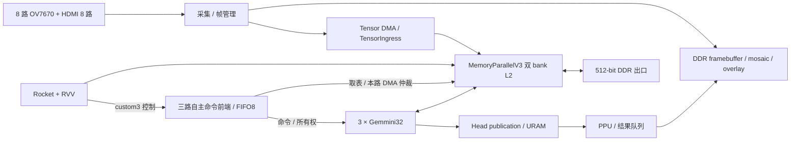

# 当前硬件架构

唯一 Config 为 `TaihangSoC1Rocket1RVV3Gemmini32x32MemoryParallelV3TensorIngressConfig`，交付别名 `triple32_v3_tensor`。
顶层为 [top_wrapper.sv](../../hw/rtl/top_wrapper.sv)，生产输入由 `hw/manifests/` 列出。

八路 OV7670 DVP 与一路 4K30 HDMI 中封装的八路 640×480 图像组成十六路输入。显示路径按通道缩放为 360×270，使用 RGB565 和每路四个 framebuffer 槽，mosaic 输出 1920×1080p60。
AI 路径独立产生 640×480×3 NHWC RGB INT8，每帧 921600 字节，使用 32 个 Tensor 槽及当前专用 TensorIngress；三颗 Gemmini 是三个计算 worker。

SoC 目标为 100 MHz，三路 DIM32 Gemmini 均启用当前 MaxPool。按照既有逻辑 worker 0/1/2，native opcode 改为 custom2/custom1/custom0，前端 lane 为 2/1/0；custom3 保留为前端控制。CSR 与 SLR 对应关系不变。详见 [命令前端](command-frontend.md)。V33 独立基准按物理 lane0/1/2 运行，实时 v26 Runtime 尚未适配。
MemoryParallelV3 保持双 bank、512 KiB L2、512-bit/ID2 内存出口；Tensor 为 256-bit/ID5 AXI 入口，统计 ABI 为 1.1。
cache 五通道寄存队列、同步 refill reload 和 set 所有权保持原实现；每 bank 的 secondary 共享池独立扩至 68 项。生产 Head 读路径启用按 AXI ID 保序的解耦队列，写路径和 PPU 所有权语义保持不变。详见 [Head/L2 候选实现](head-l2-urgent.md)。

`hw/rtl/` 保存板级视频、总线、DDR、控制及 AI 外设；`hw/soc/source/` 保存 SoC 生成源。
生成器仍在 `tools/soc/`，唯一生成导出路径见 [current.json](../../hw/manifests/current.json)。
Vivado Tcl、XDC、placement/pblock 和 timing hooks 沿用当前策略，目录收敛不修改层级或约束。
结构/RTL 回归、局部综合、整机实现、最终时序与板测分别见 [当前验收](../validation/current.md)。
