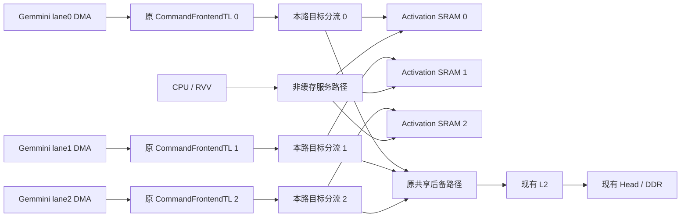

# sixteen_camera：ASRAM-1 每路私有激活 SRAM 实施规范

> **执行对象：Codex。交付内容：软硬件联合候选版本、自动验证、可复现构建与独立回退。**
>
> **核心目标：将三路 Gemmini 的 activation arena 迁到各自就近的片上 SRAM，使这些访问在进入共享 L2 之前分流。**
>
> 本文是待执行的工程规范。本文生成时没有修改项目代码、完成新综合或取得上板提速结果。无需等待用户补充板测即可开始实现；不能将离线通过写成整网性能已验证。

| 项目 | 本次范围 |
| --- | --- |
| 文档版本 / 日期 | ASRAM-1 v1.0 / 2026-10-15 |
| 仓库 | `Cc-aw/sixteen_camera` |
| 本文核对的远端提交 | `3440bc10a15467f7ba42bb2ffac21a343e1956d6`，分支 `main` |
| 当前分析对象 | `triple32_v3_tensor`，3 × Gemmini32，自主命令前端，YOLOv5nu 独立三图 Benchmark |
| 新存储 | **每路 2.25 MiB，三路共 6.75 MiB；每路 DMA 数据路径 256 bit** |
| 唯一迁移对象 | 每路 activation arena；参考源码逻辑容量为 **2,217,600 B** |
| 数学与调度 | 保留当前算子顺序、tiling、量化、RAW/DRAIN/HOST、SPAD 复用及硬件 PPU |
| 原有工作保护 | 保留用户本地已完成的 Head/L2 修改；不覆盖已存在的 SW-P3 工作 |
| 软件交付 | 新 ASRAM-1 ELF；同一新比特流内比较 `ddr_arena` 与 `local_arena` |
| 不在授权内 | 下载 FPGA、下载 ELF、烧写 Flash、要求用户反复手动调参上板 |

**版本说明：**固定提交是本文的源码证据，不是要求回退到该提交。执行时先保存实际本地 HEAD、dirty diff 和生成身份；在当前有效分支上实施。若本地已合入 H1/L1 或 SW-P3，保留其功能和溯源。未提供 H1/L1 之后的新日志，因此不得把旧瓶颈数值认定为新硬件现状。[S1][S2][S3][R0]

---

## 0. 给 Codex 的总指令

直接实现一个可关闭、可比较的 ASRAM-1 候选，不要将任务退回为“先加统计，等待用户板测后再决定是否开发”。可以自动分析现有源码、日志、地址空间及资源报告；这些检查用于保护正确性和确定接入位置，不是新的人工测试前置条件。

固定实施内容：

1. 建立三个独立的片上激活存储体，每个 2.25 MiB。存储体归对应物理前端 lane 使用，CPU/RVV 可经独立服务入口访问同一份数据。
2. 在每路 Gemmini DMA 汇入共享路径之前增加本路地址分流。局部 arena 访问不经过共享 L2；权重、输入、命令表、Head 及未迁移缓冲维持原路径。
3. 新增独立地址窗口、明确的 PMA/访问能力、只读能力描述与局部性能计数；不通过透明缓存副本或 DDR 镜像实现迁移。
4. 将 V33 派生软件的 arena 绑定改为显式 view，在初始化与建表前选择 DDR 或本地 SRAM。保持计算命令在地址归一化后等价。
5. 交付实际 TL/存储/CPU-RVV 集成回归、生成结构检查、资源检查和单一候选构建。在环境具备时完成集成综合与布局布线；不自动上板。

**第一版禁止叠加：**新增 Conv→Conv 直接融合、ACC→SPAD 回灌、改变 tiling、跨 lane 权重广播、整网按层同步、全量 L2 bypass、DMA v2 整包启用、迁移全部 scratch、重写实时 Runtime。

若资源或必要正确性验证不通过，应修复或将候选标记为 BLOCKED，不得悄悄缩小容量、落回共享 L2/DDR、删断言或把单路样例当作三路完成。依赖缺失时继续其他可执行部分，并准确记录未完成项。

---

## 1. 依据、概念与收益边界

### 1.1 本地证据支持到哪里

| 来源事实 | 对设计的支持 | 不得推出的结论 |
| --- | --- | --- |
| V33 正式十二帧：单前端 110,975,914，三前端 43,526,084 周期 | 有同前端扩展效率改善空间 | 新硬件仍具有完全相同周期 |
| 同十二帧、相同客户端逻辑请求量；三路 refill +34.93%，writeback +27.53% | 减少共享缓存上的私有激活流量值得实施 | 所有新增外存流量都来自激活或权重 |
| tag1 +804,748、tag7 +478,031 周期；tag1 无 Head 排空 | 不应把下一步只限制在 Head | tag1 等于 stage75 单层耗时 |
| 每路 `activation_arenas[...][2217600]`，内部采用偏移复用 | 可在不改变内部布局的前提下迁移整个 arena | 2.25 MiB 能容纳全部输入、scratch、权重与 Head |
| 已存在 B reuse、双消费者 SPAD 复用及静态规划 | 继续保护原有优化 | 可把这些已有功能重新算作 ASRAM-1 收益 |

数据来自用户报告 §3、§7～§11；软件事实来自冻结前端模型和派生入口。[S1][R1][R2]

本轮报告实际使用 MPV3 ABI 1.0/13 块，而已核对仓库为更新的接口身份。日志并未包含新的本地 SRAM 统计，本文不独立复算没有提供的原始 UART 文件。[S1 §2]

### 1.2 开源架构的借鉴范围

**NVDLA：**官方集成文档区分 DBBIF 与 SRAMIF，前者通常连接片外 DRAM，后者通常连接片上 SRAM。本方案借鉴的是“计算单元的外部数据可来自更近的片上存储”，不复制 NVDLA 的模块、总线时延指标或任意层融合能力。[W1]

**Tenstorrent：**官方文档强调数据位置和显式 SRAM/DRAM 选择；SRAM 可用于频繁访问的中间数据，但容量、局部性及访问争用仍须管理。本方案借鉴显式驻留与就近放置，不采用其 NoC 地址元组、指令或张量格式。[W2]

这里的 **Activation SRAM 是原 Gemmini SPAD/ACC 之外的后备存储**，不是扩大阵列内部 SPAD。它也不是 TensorIngress 输入槽，更不是透明 L2 cache。

```text
当前：Gemmini DMA → 共享 L2 → 必要时 DDR → 下一算子的 DMA
目标：Gemmini DMA → 本路 Activation SRAM → 下一算子的 DMA

原 SPAD、ACC、量化与执行阵列继续存在；局部 DMA 搬运并未被取消。
```

### 1.3 不能把容量、流量和时延混为一谈

2.115 MiB 左右的 arena 可被不同层反复复用；它的大小不等于每帧搬运总量。迁入 SRAM 可以减少共享路径上的请求，但原先命中 L2 的字节不能被算成同量 DDR 节省。

本文不规定“必定提高 20%”或“保证 3×”。提高本地存储速度、减少共享 L2 压力和恢复三路扩展效率是设计目标；每项均需相应路径与周期证据。

---

## 2. 固定配置与不变量

### 2.1 容量与组织

| 参数 | 本版决定 |
| --- | ---: |
| `ASRAM_BANK_COUNT` | 3 |
| `ASRAM_BYTES_PER_BANK` | 2,359,296 B = 2.25 MiB = `0x240000` |
| 参考模型 `ACTIVATION_ARENA_BYTES` | 2,217,600 B = `0x21D680` |
| 每 bank 余量 | 141,696 B = `0x22980` |
| 三 bank 有效容量合计 | 7,077,888 B = 6.75 MiB |
| DMA beat | 32 B = 256 bit |
| 每 bank 逻辑 word 数 | 73,728 |
| 地址窗口保留跨度 | 每 bank 4 MiB；仅前 `0x240000` 是有效 SRAM |
| 存储/控制时钟 | 与对应 SoC 数据通路一致，目标 100 MHz；本版不新增时钟域 |
| DMA 端 | 每 bank 一个独立 TL 数据入口，支持读与写 |
| CPU/RVV 端 | 访问相同存储的服务入口，不复制数据，不经过共享 L2 |
| 初始化 | 数据阵列不挂复位；软件在运行前按原语义初始化 |

以上是工程配置选择；如果实际有效模型 arena 或完整 DMA 足迹超过容量，必须报告容量冲突，不得截断、取模或只修改声明让检查通过。

**非二次幂容量必须严格解码。**不能用 `offset & (size - 1)` 实现 `0x240000` 的取模；4 MiB 窗口尾部 `0x1C0000` 为空洞，不得映射到有效数据或继续落入 DDR。

### 2.2 保持不变

保持 3 × DIM32、数值类型、FP16 scale/LUT、SPAD/ACC 容量、输入尺寸、完整模型、硬件 PPU、Head 槽与发布协议不变。保留既有 H1/L1、L2 bank/set 映射、DDR 出口和 TensorIngress。

不删除原有 DRAIN，不放宽 Gemmini busy、HOST 前置完成和 PPU 生命周期。保留 custom0/1/2 与 custom3 的已有含义。新增能力寄存器属于扩展接口，不能伪装成“系统完全没有新增软件接口”。

新硬件须保留原 DDR arena 可用路径。旧 V33 可作为兼容性回归对象；**本地 SRAM 收益需要新软件绑定，旧 ELF 不会自动迁移 arena。**

---

## 3. 执行前的自动核对

### 3.1 保存真实起点

运行并保存 `git rev-parse HEAD`、`git status --short`、源码 diff、当前硬件 manifest、软件锁、生成上下文及可用资源报告。

不得 `reset --hard`、覆盖用户尚未提交的 H1/L1/SW-P3，或继续使用未包含当前覆盖源码的旧 Chipyard workspace。新增工作应使用独立提交或补丁序列，便于分项回退。

### 3.2 明确 lane、RoCC 和 SLR 对应

V33 Benchmark 以物理 frontend lane 运行；项目其他代码还使用逻辑 worker 与 BuildRoCC 顺序。不能假设 `roccs(i)`、custom opcode、frontend lane 与 SLR 编号全部相同。[R3][R4]

生成 `activation_sram_topology.json`，明确每行：

```text
frontend_lane, native_opcode, build_rocc_index,
dma_node_path, cpu_service_node_path,
local_manager_path, external_manager_path, target_slr
```

软件的 `view[lane]` 必须与真实 DMA 入口对应。至少用三路不同数据模式证明没有互换 lane0/lane2，不能只看结构中出现了三个实例。

### 3.3 建立实际内存与资源清单

自动核对以下三项后继续开发：

- 地址：当前所有 manager AddressSet、可见别名、外部 DDR 范围、Head/Tensor/CSR、固件和栈/堆范围。
- 资源：当前整机/分 SLR 的 URAM、BRAM、LUT、布线状态和来源提交；缺报告则生成局部综合报告，标注其不能证明整机可容纳。
- 流量：导出实际计划中的 arena 读写、CPU HOST 访问及完整 DMA 包覆盖范围，而非只检查指针起点。

这些都是自动工程检查；无需等待新的用户板测。不能因缺性能计数而不实现主体，也不能因总器件有 URAM 就略过每 SLR 容量检查。

---

## 4. 目标互连：本路分流、共享后备、单份数据

### 4.1 基本拓扑



此图是待实现拓扑，不表示已完成连接。

在已核对 `LazyRoCC.scala` 中，当前接线为：[R3]

```scala
commandFrontendMemory(i).node :=* rocc.tlNode
tlOtherMastersNode :=* commandFrontendMemory(i).node
```

**优先在 `CommandFrontendTL` 下游、本路汇入 `tlOtherMastersNode` 之前分流。**这样原前端 source31 租用模块继续观察该路的所有 DMA A/D 生命周期；命令表仍在原地址范围，只走后备路径。[R3][R4]

不要先把 DMA source 拆成两个独立编号空间，再随意拼回返回。若实际参数协商要求调整接入位置，必须在拓扑报告中解释 source 生命周期，并完成 source31 与双目标并发回归。

### 4.2 两类入口，共用一份 backing memory

每 bank 有两个逻辑 TL manager 入口：

- `dmaNode`：本路 Gemmini 数据入口，256-bit。
- `serviceNode`：CPU/RVV 服务入口，按实际总线宽度适配到同一个存储体。

这两个 manager 服务同一份字节存储，但位于不同的请求可见路径。**禁止分别实例化两个 RAM 后称它们共享同一地址；禁止 CPU 通过 DDR shadow 读取。**

CPU/RVV 的访问可经过共享服务互连，但不能先进入 InclusiveCache；Gemmini 快路径不能依赖该服务互连的全局仲裁。需核对 RocketTile 中 RVV 的实际 `atlNode/tlNode` 连接，不能只验证标量 CPU。[R5]

### 4.3 地址过滤与错误路径

本路 DMA 只能正常访问本路 SRAM 窗口。访问其他 lane 的 SRAM、窗口空洞或禁止的扩展控制区域，进入明确的错误 responder；不得通过 CPU 服务入口绕行成功，也不得静默转发到 DDR。

后备分支必须从 manager 可见范围中排除本地 SRAM 的全部保留窗口，而不是依靠多个重叠 manager 的连接先后来决定优先级。

所有合法 DDR、Head、权重和命令表地址保持原路径，不扩大已有 bit31 alias 转换的适用范围。生成阶段检查每个请求来源看到的地址集合不存在意外重叠、不可达或回环。

### 4.4 为什么不用全局 idle 后切换

不得在本地/后备目标切换时等待该 lane 所有其他事务完成，更不得等待其他两个 lane。跨目标可以并发，前提是满足现有 TL source 和请求顺序契约。

可以使用项目已有的 TLXbar、TLBuffer、TLFilter 等已验证组件组织分流。新增仲裁不得引入饥饿；多 beat A/D 消息应按当前 TL 契约锁定，不打散数据归属。

---

## 5. 地址空间、PMA 与能力描述

### 5.1 地址是生成契约，不在本文猜一个常量

当前仓库存在低地址设备区、CPU DDR alias、Head 固定区域与固件映像区；“链接脚本没有使用”不等于“没有硬件 manager 覆盖”。[R6]

由 Codex 根据 §3 的完整可见范围选择三个 4 MiB 对齐窗口和一个控制页，产生**唯一权威地址 manifest**。本文件不预先把某个未经验证的物理地址写成生产地址。

选择规则：优先使用当前 manager 真正未覆盖、且不与 alias 冲突的合法低 32-bit 范围。若只能从宽泛 DDR aperture 中划出，必须在所有相关 manager/filter、别名和 PMA 路径中一致排除该保留范围；保持所有已有实际分配与固定区域不变，记录精确差异，不缩改整个 DDR 配置来图省事。

为新 SRAM 不创建 DDR 镜像，不提供第二个可缓存别名。窗口必须满足：

```text
base[i] % 0x400000 == 0
base[i] + 0x400000 <= 2^32
valid[i] = [base[i], base[i] + 0x240000)
reserved[i] = [base[i], base[i] + 0x400000)
reserved[i] 与既有实际分配、控制页以及其他 reserved[j] 不重叠
```

参考 Gemmini 软件头包含 `MAX_BYTES=64`，但其中 `ADDR_LEN` 属于 Gemmini ABI，**不能仅凭该宏推断整个系统物理地址宽度**。真正约束须逐项核对 DMA vaddr、前端 RAW/relocation 校验和 TL 地址宽度；本版选择低 32-bit 窗口以避免扩大接口范围。[R7][R4]

### 5.2 输出单一地址源

建议新增 `hw/manifests/activation_sram.json`，并由它生成 Scala 常量、C 头和测试参数。若项目已有统一地址生成器，接入该生成器，不维护多份手工常量。

交付 manifest 至少包含：

```text
schema, abi_major, abi_minor, enabled,
base_by_frontend_lane[3], reserved_stride_bytes,
physical_bytes_per_bank, logical_arena_bytes,
control_base, control_bytes, data_width_bits,
clock_hz, max_transfer_bytes,
source_topology_digest, hardware_generation_digest
```

`activation_sram_map.h` 中的常量必须由本次构建实际生成。最终交付不能还留着 `TODO_BASE`、示意地址或不匹配的硬编码。

### 5.3 非缓存必须由最终协商证明

当前参考 `PMAChecker` 使用 `supportsAcquireB` 决定 cacheable，读写能力分别检查 Get、PutFull 和 PutPartial。[R8]

因此必须同时满足：

- SRAM 地址在 CPU/RVV 最终 PMA 视图中：可读、可写、支持所需部分写，**不可缓存、不可执行**。
- 不向该区域声明 AcquireB/AcquireT；本版不支持原子操作、LR/SC 或一致性缓存分配。
- 不经过 L2 的自动缓存化路径；修改末端 manager 的 `regionType` 名字不能代替实际验证。
- 不将 SRAM 标为有读/写副作用的寄存器空间，导致普通 RVV 内存操作被拒绝或改变语义；使用实际代码支持的普通幂等内存属性，并做生成/执行检查。

不要修改冻结 `PMA.scala` 以全局关闭 CPU cache。应当通过正确的 manager 参数、连接和地址过滤得到新区域属性。

### 5.4 能力描述与旧硬件

新增只读 magic（例如 `ASR1`）、ABI、启用 bank mask、lane→base、容量、接口宽度和时钟描述；寄存器页地址由 manifest 分配。

新 ASRAM-1 比较 ELF 以“匹配的新硬件”为运行前提，启动时校验能力后才访问本地 arena。**不能在未知旧 bitstream 上盲读一个不存在的 MMIO 寄存器，然后宣称可自动回退。**

旧硬件使用保留的 V33 或 DDR-only 构建。新硬件上的 `ddr_arena` 是软件比较/回退模式，不等于旧硬件支持 ASRAM-1 的能力页。

保留现有 MPV3 ABI、块数解释与槽位意义。本地 SRAM 统计使用独立页，不占用旧保留槽却仍沿用旧 ABI 名称。

---

## 6. 存储实现与资源预算

### 6.1 选定的逻辑端口模型

每 bank 使用一个共享 backing array、两个真实读写端口，时钟相同：

| 物理端口 | 主要客户 | 本版吞吐解释 |
| --- | --- | --- |
| A | 对应 lane 的 DMA | 一拍最多一个 256-bit 存储操作；读写复用 |
| B | CPU/RVV 服务入口 | 经宽度适配，一拍最多一个 256-bit 存储操作 |

**不能把两个物理端口算成“DMA 一读一写并发，再额外提供 CPU 第三个端口”。**本版不引入多泵时钟或复制写入实现多读口。

DMA 流式读取应能在填满流水后每周期完成一个 32B 存储读；顺序写入同理。混合读写共用端口 A，不能宣称每周期同时搬出 32B 并搬入 32B。TL 请求/响应组合的具体峰值须分别报告。

### 6.2 UltraRAM 组织

建议使用显式受控的 UltraRAM 存储包装模块，支持 32 个字节 mask。允许使用项目已有且经局部综合证明正确的推断方式；若推断不稳定，使用 Vivado 2023.2 对应的受支持原语/模板，不升级工具链来绕过问题。

在每块 UltraRAM 使用 4K × 64 有效数据位、忽略额外 parity 容量的组织假设下：

```text
单组宽度：4 块 × 64 bit = 256 bit
单组深度：4096 words × 32 B = 128 KiB
每 bank：18 组 × 128 KiB = 2.25 MiB
预算：72 URAM / bank，216 URAM / 三 bank
```

这是**预算，不是综合结果**。厂商文档说明 UltraRAM 的 4K × 72 结构及 byte-write 模式；具体包装须核对数据/parity 位映射和 BWE，不能把 AXI/TL byte mask 随意连到错误的 9-bit 分组。[W3][W4]

本版不启用要求全字写入的 ECC 模式，不增加软件不可见的自动 RMW 来掩盖部分写语义。若使用 parity 位，映射及有效容量须在报告中单独列出；不能把未使用的 parity 位同时算进有效容量。

### 6.3 流水与时序

数据 RAM 不挂复位；复位仅作用于 valid、队列、credit、统计控制和所有权状态。同步读数据与对应 source/size/offset/error 元信息经过相同级数。

使用层次化 bank 选择和寄存返回，避免 18 组深度级联形成全芯片宽组合 mux。ready 路径采用有容量的弹性缓冲终止，不把 URAM ready 或上游 DREADY 组合传播到其他 SLR。

本地读流水深度设为可配置并实际记录；不能为了声称“一周期 SRAM”取消寄存级。没有 stall 时应维持目标 initiation interval，首拍时延与连续吞吐分别报告。

### 6.4 同地址冲突

CPU/RVV 和 DMA 对同一 word 的读写碰撞不得依赖未明确约定的器件行为。控制器提供冲突检测，对存在写入的同 word 跨端口访问序列化，并考虑已进入写流水但尚未提交的操作。

同周期冲突的仲裁顺序固定且可测试；被阻塞请求保持稳定。对不同 word 的独立访问允许并行。软件仍遵守 §8 的所有权，硬件碰撞规则是确定性保护，不是允许两个生产者随意同时修改同一 tensor。

### 6.5 资源准入

局部综合要给出实际 URAM/BRAM/LUT/FF、数据 RAM 是否被复制、每 bank 分布及流水延迟。全设计再检查实际剩余资源和局部 SLR 余量。

不能把 6.75 MiB 全部实现成寄存器或大量 LUTRAM 后仍报“SRAM 方案完成”；大容量存储与小队列分别统计。禁止侵占 Head 槽、减少 SPAD/ACC 或关闭视频模块给本次腾资源。

若无法按约定容量实现，提交准确的资源阻塞原因与已通过的模块，不默认改成 256 KiB 小缓存或软件 spill。该变化属于另一架构方案。

---

## 7. TileLink 协议、credit 与返回仲裁

### 7.1 支持范围

本版最低完整支持当前 Gemmini 使用的 `Get`、`PutFullData`、`PutPartialData`，自然对齐的 1/2/4/8/16/32/64B 事务；参考软件 `MAX_BYTES=64`，须以实际协商与真实请求确认。[R7]

CPU/RVV 入口按其实际协商处理宽度与传输大小；若需要 fragmenter/width widget，将其纳入验证，不能只测字节数组模型。

不实现新 Acquire、Probe、Atomic 或 Hint 功能。对不在协商能力内的消息，协议 monitor 应发现；对合法 opcode 但地址非法的访问，以正确的 denied/error 响应结束，不能静默返回零和成功。

所有地址检查覆盖**整个事务**，不是只看首地址。支持有效区最后一个完整合法请求，拒绝跨越有效尾部、保留洞或地址溢出的请求。

### 7.2 多 beat 请求

256-bit 总线上的 64B Put 有两个 A 数据 beat，64B Get 有两个 D 数据 beat。锁定所属 transaction、source、size、目标及地址推进，遵守现有 TL 不交织规则。

Put 只产生一次 AccessAck。Ack 不早于所有有效写 beat 对 backing memory 完成可见提交；Get 的 AccessAckData 必须在真正的数据返回后发出。

拒绝事务需消费协议要求的剩余 beat，并返回合法错误，不得因首 beat 错误就永久压低 ready。对 malformed 协议事务，由测试/monitor 报失败，不尝试以伪成功修复。

### 7.3 分离请求容量和响应 credit

采用请求描述符、存储操作流水、响应 FIFO 分离的结构。建议：

- DMA 本地接受能力不少于 32 笔，并核对当前 lane 的实际并发契约；不得把读/写各自的 source 数误当成总额度，也不缩窄现有 sourceBits。
- DMA D 返回弹性队列初始按 8 beat 配置；这是 beat 容量，不是 8 笔任意长度事务。
- CPU 服务端有独立队列和 credit，不与三个 DMA 共用一个全局槽。
- 对每一个不可撤回的同步读，在发射前预留对应返回 credit；计算包含管线中的未返回读，不能只看 FIFO 当前 occupancy。

示意不变量：

```text
response_fifo_occupied + issued_reads_not_enqueued <= response_capacity
accepted_transaction 尚未退休 → 请求/执行/返回至少一个状态拥有它
accepted_count - final_D_handshakes == outstanding_count
```

实际算法可以更细分，但必须证明请求、数据与 credit 都不会丢失。读响应不可因 FIFO 满而丢弃；写 Ack 也必须有保留容量。

### 7.4 source、顺序与前端 source31

保留 actual source 字段的完整宽度以及响应 size/opcode/corrupt/denied 信息。不能把 source 当作 lane，也不能把来源端口字段丢掉后仅凭相同 source 返回。

`CommandFrontendMemoryMux` 会在 DMA 未占用时租用 source31，并在最终 D beat 释放。[R4] 新路由必须验证：本地 DMA source31、后备 DMA source31、前端取表、反压和同拍完成/新发射的组合。

同一 DMA source 在事务完成前不得再次用于另一个事务；不同 source 的返回能否乱序，以及 `requestFifo/fifoId` 的要求，以协商结果为准。不能为了本地返回更快就越过必须保序的旧请求。

局部和后备 D 返回采用公平、消息完整的仲裁与缓冲。独立 source 的本地请求不应因其他 source 的 DDR 延迟被全局排空条件阻塞。若现有 FIFO 语义导致不可避免的约束，须写清并验证，不擅自放松协议。

### 7.5 错误与复位

非法地址不允许写入有效存储。收到 corrupt 写入、协议错误或其他不可恢复错误时，返回或记录错误并让本帧失败，不能把污染的数据送入成功路径；若部分 beat 已提交，明确将该帧视为无效并要求重新初始化。

仅清统计不清功能 outstanding。运行中不得用本地软 reset 丢掉已接受事务；如需重置整个功能链，应协调上游，或先排空后复位。系统全局 reset 后所有 response-valid 清零，不能泄漏上一轮回复。

---

## 8. CPU/RVV 可见性与所有权

### 8.1 以现有执行边界为所有权基础

第一版不新增每 tile 的 CPU 锁，也不要求三个 lane 一起停机。每 lane 单帧状态遵循：

```text
初始化/空闲：CPU 可初始化本 lane arena
RUN/DRAIN：本 lane Gemmini 是计算访问者
HOST：先满足原本地完成条件，再执行该 HOST 的 CPU/RVV 访问
RESUME：CPU/RVV 写入对下一使用者可见后，恢复本 lane
DONE：所有本帧本地事务已按完成契约退休
```

其他 lane 继续运行。不要把 lane0 的 HOST 变成等待三个 Gemmini idle 的全局屏障。

### 8.2 HOST 不等于可以忽略 DMA

必须逐个核对六次 PAD/copy 的实际源、目标、偏移和长度。迁入的 arena 源指针改为本地 view；未迁移的 `memory_pad`、`memory_intermediate` 仍在原处，允许一次 HOST 同时读 SRAM、写 DDR。[S1 §5][R1]

不能用“HOST 表项已出现”替代原有 Gemmini 本地完成证明，也不能在尚有本地写入时让 CPU 读同一 tensor。

### 8.3 CPU/RVV 写入到 RESUME 的边界

沿用原有 `gf_publish()`/内存与设备顺序约束，并实现明确的 `activation_memory_commit()`：证明 CPU 与 RVV 写缓冲、服务路径队列及必要的存储提交已完成，再允许依赖这些数据的命令启动。

`fence rw,rw` 可以是其中一环，但其对当前独立 RVV/Saturn 访问路径的覆盖必须由实际接口和测试证明。单纯 `volatile`、编译器 memory clobber 或读一个无关 CSR 不是跨来源完成证明。

若用同地址空间 readback 证明写入可见，必须验证它与 CPU/RVV 先前写入的顺序关系。来自另一 TL source 的 readback 不能无条件视作已经排空全部旧写。

### 8.4 busy 与完成

首选使现有 DMA 通过正常 TL D 回复获知真正完成，继续由既有 tracker/busy/DRAIN 判断状态。新本地 request FIFO 中的写不能在入队时就产生成功 Ack。

如新增未被原 tracker 覆盖的写缓冲，其未提交状态必须纳入本 lane 的完成证明，不能建立一个数据仍在缓冲、Gemmini 却已 not-busy 的空窗。

新增能力不改变 Head publication 条件；即使 Head 仍在原路径，本地生成的中间结果也必须先正确完成。

---

## 9. 软件迁移：显式 view，不改模型内部布局

### 9.1 真实入口

本次从 `sw/benchmarks/frontend` 的当前有效派生入口工作。参考链为：[R2]

```text
frozen/frontend_v33/sources.lock.json
    → sw/benchmarks/frontend/scripts/prepare.py
    → generated/graph.inc、fixed/prepared packets
    → src/main.c + src/ppu.inc
    → ELF
```

不直接编辑冻结模型使其变成新基线，不只修改实时 `model.c` 后声称 Benchmark 已生效。若本地存在 SW-P3 派生框架，复用其 storage/view 与构建机制，另设 ASRAM 存储策略。

### 9.2 view 的最小契约

建议数据结构（字段表达约束，不强制特定命名）：

```c
typedef enum {
    ACTIVATION_MEMORY_DDR = 0,
    ACTIVATION_MEMORY_LOCAL = 1
} ActivationMemoryKind;

typedef struct {
    int8_t *cpu_base;
    uintptr_t dma_base;
    size_t logical_bytes;
    size_t physical_bytes;
    unsigned frontend_lane;
    ActivationMemoryKind kind;
} ActivationArenaView;
```

本版本地窗口优先使用 CPU 和 DMA 相同的物理数值地址，独立于 DDR alias。仍显式区分两个字段，用于防止旧 DDR alias helper 被不加选择地应用。

若项目的包编码直接使用 CPU pointer，必须保证生成到 DMA 的地址正好是 manifest 地址；不得在所有 RAW 字段上统一 OR/AND bit31。

### 9.3 第一版只换整体基址

保留 `tensor_x = activation_base + old_offset` 的关系及所有已有合法重叠视图。保持 shape、stride、量化、tiling、内部生命周期完全不变。

保留 DDR backing storage 供参考路径和兼容测试。切换 storage mode 后必须在建表前重新绑定所有受影响指针；不能在已运行的命令表上改地址。

必须审计：

```text
select_worker_memory / activation_arena
batch_conv_bindings / batch_ws_bindings
HOST PAD 的 src/dst
normalized_address / normalize / operand range checks
prepare_model / capture / prepare_batch
memset / tensor_fill / tensor_hash / guard 检查
worker_arena 查询与任何保存的指针快照
```

数组变指针后，所有容量使用 `logical_bytes/physical_bytes`，不能继续 `sizeof(pointer)`。对嵌入 rs1/rs2 的地址只修改已证明的地址字段，不能误改 FP16、stride 或本地 SPAD 地址。

### 9.4 模式与已有 SW-P3 的隔离

核心比较只含两个 storage profile：

- `ddr_arena`：使用当前有效计算计划和 DDR 激活区。
- `local_arena`：相同计划、相同边界，激活区在 SRAM。

两者共享同一 tiling、权重、输入、调度器与其他缓冲放置。若 SW-P3 已选定新 tiling，两种 storage mode 都使用同一份，并记录 digest；不得只让其中一种叠加 S2 或 Head gate。

第一版不把 S1 的 L2 coloring 用到局部 arena 内部；其他仍在 L2 的对象可保留既有布局。Head gate 的开关在两个 profile 中相同，默认不要新增。

### 9.5 初始化和回退

启动时先校验能力和容量，再初始化 arena、绑定指针、生成计划。模型本来要求清零的区域在两个 profile 中保持同样语义，不能假设 URAM 上电为零。

不在每帧前后复制整个 arena 到 DDR。参考与候选切换只能在前端、DMA、CPU/RVV、PPU 等有关操作排空之后进行，并重新初始化/建表；禁止热切换未完成帧的 backing storage。

若某依赖必须长期读取激活历史数据，先通过实际图验证；不能借“私有 arena”提前释放仍被消费的张量。

### 9.6 主机测试与计划等价

主机端为本地 arena 使用模拟 backing allocation，禁止解引用硬编码 FPGA 地址。主机 oracle 与候选都使用明确 view 容量和独立 guard。

按照地址类别与逻辑偏移归一化后，两个 storage mode 的 RAW 序列、数量、非地址操作数、DRAIN 和 HOST 应完全一致；参考 V33 为每帧 10,478 RAW、380 DRAIN、12 HOST，但如本地已合入有证明的 SW-P3，锁定本地实际计划，不硬回退旧计数。[S1 §7]

不得降低原计划检查要求以容纳错误地址，也不允许只比较 command_count 而跳过操作数。

---

## 10. 流量清单、计数与性能解释

### 10.1 静态清单先于性能推断

离线导出 `activation_access_inventory.json`，记录各 stage 的读/写 arena 范围、logical tensor、最大事务跨度、CPU HOST 访问、是否迁移及原因。

区分 pointer 所指对象、实际 strided DMA footprint 和估算请求次数。NULL/skip-A/skip-B、已有 SPAD 重用和省略输出的 packet 不能按普通读写重复计数。

计划层的清单用于证明作用范围，不伪装成已经取得了逐周期 RTL trace。无法精确展开的流量标为 unknown/upper_bound，不填入看似精确的 DDR 节省值。

### 10.2 新增局部计数

独立 ASRAM 页按 bank 至少提供：

| 类别 | 计数 |
| --- | --- |
| 本地请求 | Get、PutFull、PutPartial 接受数；请求读字节；有效写 mask 字节 |
| 响应 | 返回读 beat、写 Ack、响应反压；accepted/retired 事务 |
| 排队 | A 反压、请求容量满、读返回 credit 不足、占用峰值/积分 |
| 存储 | 读发射、写提交、端口冲突阻塞、服务端访问数/字节 |
| 错误 | 越界、foreign-lane、denied、corrupt、协议/内部错误 sticky |

所有局部计数在同一 SoC 域；CLEAR 不重置功能事务跟踪。64-bit 计数通过冻结 snapshot 或一致的高低字读取，不能输出撕裂值。

当前 MPV3 client tap 若位于分流之后，将不再包含本地字节，这是观察点变化，不是减少数学工作。日志必须标注 tap 位置，并能核对 `local + external` 与总逻辑访问的关系。

### 10.3 路径成立的验收

纯本地定向测试中，经过本路分流器的 SRAM 地址不能出现在共享 L2/后备端口；全模型混合测试中，仅声称已迁移地址范围被移走，不要求整个 L2 或 DDR 没有活动。

反向也须验证：权重、输入、命令表和 Head 不能被错误吸收到本地 SRAM；CPU/RVV 在本地范围的请求不得产生 L1/L2 缓存分配。

### 10.4 目标指标

在同一新比特流下分别测两个 storage profile：

```text
absolute_gain = T(ddr_arena, frontend_parallel) / T(local_arena, frontend_parallel)
scale_ddr = T(ddr_arena, frontend_serial) / T(ddr_arena, frontend_parallel)
scale_local = T(local_arena, frontend_serial) / T(local_arena, frontend_parallel)
```

同时保留 direct_serial 为原有兼容/正确性参照，但不用旧二进制较慢的串行路径人为放大扩展比。

历史 3× 的固定参考门槛为 `floor(110975914/3)=36,991,971` 周期；该数字不替代新硬件同 profile 的实际分子。[S1 §3]

容量驻留可能同时改善串行和并行。只提高绝对 FPS 而扩展比变化小，也可能是真实收益；反之，仅提高比值但绝对三路周期变差不算优化成功。

---

## 11. 新增与修改文件

### 11.1 新增硬件模块的建议布局

```text
hw/soc/source/activation_sram/
  README.md
  scala/
    ActivationSramConfig.scala
    ActivationSramSubsystem.scala
    ActivationSramTL.scala
    ActivationSramPerf.scala
  resources/
    activation_sram_store.sv
  tests/
    [协议/存储级测试支持]
```

以上是建议新增文件，不是声称仓库已经存在。物理存储包装可按实际代码风格拆分，但不建设通用新 NoC 框架。

现有接入点：[R3][R4][R5]

```text
hw/soc/source/command_frontend/integration/
  generators/rocket-chip/src/main/scala/tile/LazyRoCC.scala
  generators/rocket-chip/src/main/scala/tile/RocketTile.scala
hw/soc/source/command_frontend/scala/CommandFrontendMemory.scala
```

`CommandFrontendMemory.scala` 优先保持租用算法不变，仅作为必须验证的依赖。CPU 服务连接需要时使用当前 tile/subsystem 的有效源码；不要修改冻结 reference 然后靠旧 overlay 覆盖出另一版。

### 11.2 生成与结构检查

需要接入当前实际生效的：

```text
tools/soc/build_triple32_v3_tensor.py
hw/manifests/current.json
hw/manifests/activation_sram.json              [新增]
tools/check/check_triple32_v3_tensor.py
tools/check/check_activation_sram.py            [新增]
```

当前生成流程先恢复 reference，再安装 V3，再安装 frontend integration。新增源码和资源必须进入真实编译闭包；最后生效的 LazyRoCC/RocketTile 修改不能被后续复制覆盖。[R9]

更新项目既有锁和 import manifest 中实际发生变化的项，保留冻结来源哈希。重新生成 RTL、metadata 和 C header；不手工补丁生成 `.sv` 来代替源码实现。

原结构检查中 e34/e68 等要求以本地已实现 L1 为准，本任务不把 H1/L1 改回历史默认。

### 11.3 软件、验证与构建建议

```text
sw/benchmarks/frontend/
  scripts/prepare.py
  src/main.c
  src/ppu.inc                              [尽量不改]
  include/activation_memory.h             [新增或复用已有 view]
  src/activation_memory.c                 [新增]
  scripts/activation_sram_manifest.py      [新增]
  scripts/analyze_activation_sram_log.py   [新增]

tests/rtl/activation_sram/                 [新增]
tests/model/activation_sram/               [新增]
docs/validation/activation-sram.md         [新增]
```

复用现有 Benchmark，不另起一套漂移的 YOLO 数学源码。候选产物使用独立输出目录与文件名，不覆盖原 V33 ELF。

---

## 12. 自动验证矩阵：必要项不得用 mock 替代

| 编号 | 层次 | 必须覆盖 |
| --- | --- | --- |
| A01 | 地址/拓扑 | 三 lane manager、物理 lane 映射、全部保留窗口/alias/空洞、无 decode 回环 |
| A02 | 真实存储 | 首/尾 word、18 个深度组边界、byte mask、随机地址、重复写、同步读延迟 |
| A03 | TL 基础 | 1～64B 的 Get/PutFull/PutPartial；64B 两 beat；正确 opcode/source/size |
| A04 | 反压 | 随机 A/D stall、响应 FIFO 填满、不可撤回读返回、同拍入队/出队、credit 守恒 |
| A05 | 混合目标 | local 与 DDR 不同 source 并发；DDR 长延迟时本地不被全局排空；公平返回 |
| A06 | 前端租用 | source31 本地/后备 DMA、前端取表、连续请求及最后 beat 释放 |
| A07 | 错误 | foreign-lane、窗口尾洞、整段越界、非法消息、corrupt、错误后无静默成功 |
| A08 | CPU/PMA | 标量读写本地窗口；无 cache allocate；CPU 与 DMA 访问同一 backing bytes |
| A09 | RVV | 当前 RVV/Saturn 路径执行真实 PAD/copy，写入→完成→RESUME 可见性；不能只测 memcpy mock |
| A10 | 双端口 | 不同 word 并发、同 word 读写/写写冲突、流水中写入的保护及仲裁顺序 |
| A11 | 生命周期 | DRAIN/HOST/DONE、复位、统计 CLEAR、错误排空、不发送迟到上一帧回复 |
| A12 | 计划等价 | DDR/local 归一化后的完整 RAW/边界/非地址操作数一致；完整访问范围与 guard |
| A13 | 三路真实计算 | 三个不同输入模式、本地中间结果、后备权重、原始输出逐字节比较 |
| A14 | 集成回归 | 现有 frontend、L2/H1/L1、TensorIngress、PPU 和视频相关必要回归 |
| A15 | 生成/综合 | 源码实际生效、三个真实 RAM、无意外复制、端口/资源/布局和最终时序 |

A08/A09 不能仅通过“manager 参数打印符合预期”替代行为测试；A13 不能仅用假 Gemmini 发送器替代真实数值链。

### 12.1 分层使用模型

字节参考模型适用于协议随机回归；厂商存储模型/实际综合用于验证 primitive 语义；真实 Gemmini、Rocket/RVV 集成测试用于系统可见性和数值行为。

每条记录明确使用了哪一层。mock PASS 不能升级成实际硬件 PASS；QEMU 不支持的自定义外设不能用普通 RAM 替代后宣称 FPGA 集成正确。

### 12.2 数值比较

保留现有三图与全部 PPU 结果字比较，另添加适当的原始中间 tensor/Head 字节对照。二者不同：PPU 框数量一致不是全部 Head 一致，迁移前后相同也不是独立模型精度验证。[S1 §2、§15]

诊断读取须发生在明确安全的生产完成边界，并与正式计时分离。不得为了校验往正式路径增加每层整网 fence，再把这个较慢程序当性能基线。

### 12.3 吞吐微基准

用真实控制器、实际配置，报告：连续 Get32/Get64、Put32/Put64、混合读写、CPU 服务竞争和三个 bank 同时工作的握手效率、首拍时延与最大占用。

内存流水填满后的纯读/纯写以一拍一个 256-bit 存储操作为设计目标。达到局部峰值不代表网络达到 3×，也不允许把物理两端口带宽重复计入每个客户。

---

## 13. 实施阶段与允许的停止条件

### M0：起点冻结与地址/资源闭包

输出 topology、address manifest、资源预算和 arena 访问清单。确定 CPU/RVV 与 DMA 的完整路径，不进行上板。

准入：模型容量明确、三窗口地址合法、最小资源预算可解释、后续不依赖改动数学图。不以“没有新日志”阻止进入 M1。

### M1：存储与 TL 外围

实现真实 byte-mask SRAM、两端口控制、请求/返回 credit、错误处理与必要断言。完成 A02～A04、A07、A10～A11 的模块测试。

准入：不得存在数据覆盖、credit 漏失或无响应路径。

### M2：三路接入与 CPU/RVV 可见性

接入每 lane 分流和服务入口，保留 FE source31；生成 PMA/manager 证据并完成 A01、A05、A06、A08、A09。

CPU/RVV 可见性不通过时不能把“Gemmini 能读本地 SRAM”宣布成可运行候选。

### M3：软件绑定与等价

实现两种 storage profile、初始化、能力校验、range proof 和原生计划对比。DDR fallback 与 local mode 都须生成有效 ELF。

不移植实时 Runtime，不顺带修改 tiling；原 PPU publication 逻辑保持原有语义。

### M4：实际计算、集成与一次候选构建

完成 A13/A14，重新生成当前 SoC 和相关 headers，进行 OOC，再在环境具备时完成一个集成候选的综合与布局布线。

保留 100 MHz 目标和既有约束，不新增宽泛 false path、跨业务 multicycle 或降频。最终区分 OOC WNS 与整机 routed WNS，并检查 hold、route status、bus skew 等既有门槛。

若工具、RAM 资源或时序阻塞，仍交付源码、已完成测试与准确 BLOCKED 项，不能写出一个有负时序的 bitstream 却标记为 timing pass。

### M5：上板准备而非自动下载

生成比较 ELF、加载说明、解析器和基线清单。上板由用户另行执行；Codex 不使用本任务授权下载 FPGA/ELF 或占用正在运行的板卡。

---

## 14. 构建入口与候选产物

以下名称为**要求 Codex 新增或接入的目标**，不是声称现有 Makefile 已提供：

```text
make test-activation-sram-unit
make test-activation-sram-integration SOC_WORKSPACE=<当前重建工作区>
make test-activation-sram-software
make benchmark-activation-sram
make check-activation-sram
```

同时保留项目现有入口，包括：

```text
make check
make test-v33
make test-frontend SOC_WORKSPACE=<当前重建工作区>
make test-memory-v3
make test-cache
make test-ppu
make test-tensor-ingress SOC_WORKSPACE=<当前重建工作区>
```

实际命令以执行时的 Makefile 和工具配置为准；新增目标应记录所有依赖、参数和退出码，不因 SKIP 返回成功而将全套标记 PASS。[R9][R10]

建议候选输出：

```text
build/firmware/activation_sram/
  activation_sram_compare.elf
  activation_sram_diag.elf
  activation_sram_compare.map
  activation_sram_manifest.json

build/reports/activation_sram/
  baseline_identity.json
  activation_access_inventory.json
  activation_sram_topology.json
  address_decode_report.json
  pma_visibility_report.json
  resource_report.json
  test_results.json
  timing_summary.json
  README.md
```

路径可以按已有框架调整，但最后必须给出实际位置和 SHA256。不要生成多套复制的生产 SoC Config；在现有配置中用显式 feature 参数控制 ASRAM，候选默认开启，回退构建可关闭。

---

## 15. 一次上板可运行的自动比较套件

### 15.1 同一硬件对照

一个新 bitstream 同时支持 DDR 与本地 arena。比较套件在模式切换前排空、重新初始化并重新绑定计划，使用相同三张图、每模式十二帧及相同 lane 分配规则。

每个 storage profile 都运行：

```text
direct_serial
frontend_serial
frontend_parallel
```

正式比较与大规模诊断分开 ELF。UART 逐层打印、原始数据导出和读全部计数不得进入正式计时窗口。

### 15.2 固定计时与重复

沿用基线开始到最终结果收回的总周期口径，包括启动/尾部、HOST、PPU 及软件管理。本来位于 prepare 阶段的建表/初始化单独报告，不在候选中暗移原本计入的成本。

提供可配置但有限的自动重复次数，默认建议 3 轮，profile 顺序交替；每轮六种组合的完整结果都保留。没有用户指令，不自动运行或下载这个套件。

若两种模式的 cache 初态无法做到严格一致，应报告初始化/预热规则、交替顺序和局限，不能把单次差值包装为稳定收益。

### 15.3 必须输出的身份与结果

```text
hardware source commit / generation digest / bitstream digest（由加载清单记录）
software commit / ELF digest / model and input digests
ASRAM ABI / bases / capacity / enabled mask
storage_mode / frontend mode / round / frames / input sequence
plan normalized digest / RAW-DRAIN-HOST counts
12-frame total cycles / per-frame lifecycle / result mismatches
local/external bytes and stalls（诊断运行）
scale_ddr / scale_local / absolute parallel gain
```

ELF 打印自己的构建标识不等于证明板上实际加载 bitstream 哈希。加载清单与板上能力读回各有责任，两者都记录。

### 15.4 性能判定

成功需同时具备：结果不变、路径分流真实生效、完整十二帧三路周期下降。3× 为目标，不是可以通过改变工作量达成的形式指标。

若本地字节正确迁移但三路没有加速，继续用本地响应反压、CPU/RVV HOST 成本、混合目标顺序和资源时序定位；保留候选并报告无收益，不自动删除约束或减少模型。

---

## 16. 回退、兼容和常见陷阱

### 16.1 三层回退

| 回退层 | 方法 | 保留什么 |
| --- | --- | --- |
| 同 bitstream 软件回退 | 选择 `ddr_arena` 并重新初始化/建表 | 新 SRAM 硬件存在但不承接模型 arena |
| ASRAM 功能回退 | 关闭新增 feature、重新生成构建 | 保留此前 H1/L1 与用户其他改动 |
| 已验证产物回退 | 使用独立保存的旧 bitstream/ELF 配对 | 不覆写旧产物与其哈希 |

回退不通过修改 `golden`、忽略错误或把本地地址重映射到未同步 DDR 实现。

### 16.2 常见错误及禁止修补

| 错误 | 禁止的做法 |
| --- | --- |
| local 地址仍命中 L2 | 只改注释或额外连一个优先级不明的 manager |
| CPU 读到旧值 | 给本地存储再维护一个不完整的 DDR shadow |
| RVV 访问 trap | 将 RVV PAD 全部换成标量并隐藏成本变化 |
| source31 冲突 | 永久扣掉 DMA source31 或扩大 ID 后不回归 |
| 响应 FIFO 满 | 丢弃同步读结果、早 Ack 或增加不受 credit 控制的寄存器 |
| 容量不够 | 对地址取模、截断模型或悄悄 spill 到 DDR |
| URAM 推断失败 | 接受大规模寄存器 RAM，仍声称片上 SRAM 资源合格 |
| arena 改 pointer | 保留 `sizeof(pointer)` 清零/校验错误 |
| 独立局部资源闲置 | 仍等待共享 DDR 全部排空才发本地请求 |
| 新旧 baseline 混淆 | 用旧串行周期除新并行周期宣布同策略 3× |

标量替代、smaller SRAM、spill 或新融合方案可以成为后续独立设计，但都不是本次可以静默采用的等价实现。

---

## 17. 最终交付清单与状态定义

最终说明按以下顺序，明确结果而非只写“已完成优化”：

1. **实际修改：**三路接入图、地址、PMA、capacity、实际 URAM 组织、CPU/RVV 可见性和软件 storage profile。
2. **验证结果：**A01～A15 各自 PASS/FAIL/BLOCKED/NOT_RUN、执行命令、输入、日志位置、seed、退出码。
3. **产物身份：**实际源码起点和变更、生成 RTL/metadata/header、ELF、局部/整机报告与候选 bitstream（若产生）的哈希。
4. **兼容与回退：**原 V33 路径检查、H1/L1 保留状态、DDR-arena 比较方式、ASRAM 关闭方式。
5. **未验证内容：**未上板、未获得正式收益或不具备独立模型精度证据时逐项写明。

建议状态名：

```text
SPEC_ONLY
IMPLEMENTED_UNIT_VERIFIED
INTEGRATION_VERIFIED
RTL_GENERATED
OOC_VERIFIED
FULL_TIMING_PASSED
BOARD_CORRECTNESS_PASSED
BOARD_PERFORMANCE_MEASURED
```

只报告实际达到的状态，不将“代码合入”视为“板上性能完成”。

**最终不可替代的判定：新本地 arena 请求确实绕开共享 L2，CPU/RVV 与 Gemmini 使用同一份数据，完整结果正确；性能另由正式同硬件对照证明。**

---

## 18. 来源与核对范围

### 18.1 用户材料

- **[S1]** `frontend_v34_parallelism_memory_analysis.md`：§2 版本、§3 正式基线、§5 HOST、§7 区间、§8 等待定义、§9～§11 共享访存、§15 证据边界。本文使用报告中的数据，没有新原始日志复算。
- **[S2]** `sixteen_camera_Head_L2_urgent_codex_implementation.md`：既有 H1/L1 任务范围、接口与回退契约。本文保留这些改动，不以它们已上板为前提。
- **[S3]** `sixteen_camera_SW_P3_parallelism_codex_plan.md`：软件真实派生路径、storage/view、既有优化保护与性能比较边界。ASRAM-1 不替代或悄悄重启其 tiling 搜索。

### 18.2 已核对仓库源码

以下链接固定到本文证据提交；执行者另记录实际本地版本差异。

- **[R0]** [仓库证据提交](https://github.com/Cc-aw/sixteen_camera/commit/3440bc10a15467f7ba42bb2ffac21a343e1956d6)。
- **[R1]** [V33 冻结模型与 activation arena](https://github.com/Cc-aw/sixteen_camera/blob/3440bc10a15467f7ba42bb2ffac21a343e1956d6/sw/models/yolov5nu/frozen/frontend_v33/parallel_model.inc)。
- **[R2]** [前端派生 prepare.py](https://github.com/Cc-aw/sixteen_camera/blob/3440bc10a15467f7ba42bb2ffac21a343e1956d6/sw/benchmarks/frontend/scripts/prepare.py)；[main.c](https://github.com/Cc-aw/sixteen_camera/blob/3440bc10a15467f7ba42bb2ffac21a343e1956d6/sw/benchmarks/frontend/src/main.c)。
- **[R3]** [有效 frontend integration / LazyRoCC.scala](https://github.com/Cc-aw/sixteen_camera/blob/3440bc10a15467f7ba42bb2ffac21a343e1956d6/hw/soc/source/command_frontend/integration/generators/rocket-chip/src/main/scala/tile/LazyRoCC.scala)。
- **[R4]** [CommandFrontendMemory.scala](https://github.com/Cc-aw/sixteen_camera/blob/3440bc10a15467f7ba42bb2ffac21a343e1956d6/hw/soc/source/command_frontend/scala/CommandFrontendMemory.scala)：source31 租用、完整地址、消息锁定与最终 D 释放。
- **[R5]** [有效 RocketTile.scala](https://github.com/Cc-aw/sixteen_camera/blob/3440bc10a15467f7ba42bb2ffac21a343e1956d6/hw/soc/source/command_frontend/integration/generators/rocket-chip/src/main/scala/tile/RocketTile.scala)：CPU/RVV 节点与数据路径。
- **[R6]** [当前地址与可见性](https://github.com/Cc-aw/sixteen_camera/blob/3440bc10a15467f7ba42bb2ffac21a343e1956d6/docs/interfaces/memory-map.md)。
- **[R7]** [V33 冻结 Gemmini 参数](https://github.com/Cc-aw/sixteen_camera/blob/3440bc10a15467f7ba42bb2ffac21a343e1956d6/sw/models/yolov5nu/frozen/frontend_v33/include/gemmini_params.h)：只用于数值/包尺寸证据，旧 opcode 必须经过现有适配，不当作当前原生路由。
- **[R8]** [参考 PMA.scala](https://github.com/Cc-aw/sixteen_camera/blob/3440bc10a15467f7ba42bb2ffac21a343e1956d6/hw/soc/source/shell/reference/generators/rocket-chip/src/main/scala/rocket/PMA.scala)：最终仍需核对执行 workspace 的有效版本。
- **[R9]** [SoC 生成器](https://github.com/Cc-aw/sixteen_camera/blob/3440bc10a15467f7ba42bb2ffac21a343e1956d6/tools/soc/build_triple32_v3_tensor.py)；[结构检查](https://github.com/Cc-aw/sixteen_camera/blob/3440bc10a15467f7ba42bb2ffac21a343e1956d6/tools/check/check_triple32_v3_tensor.py)。
- **[R10]** [验证入口说明](https://github.com/Cc-aw/sixteen_camera/blob/3440bc10a15467f7ba42bb2ffac21a343e1956d6/tests/README.md)；[前端 Makefile](https://github.com/Cc-aw/sixteen_camera/blob/3440bc10a15467f7ba42bb2ffac21a343e1956d6/sw/benchmarks/frontend/Makefile)。

### 18.3 外部一手资料

- **[W1]** [NVDLA v2 Integrator’s Manual — System Data Interfaces](https://nvdla.org/hw/v2/integration_guide.html)：DBBIF/SRAMIF 的存储层次依据。
- **[W2]** [Tenstorrent — Memory from a kernel developer’s perspective](https://docs.tenstorrent.com/tt-metal/latest/tt-metalium/tt_metal/advanced_topics/memory_for_kernel_developers.html)：显式 placement、SRAM buffers 与中间数据驻留；网页为 latest，执行时记录本地引用版本，不将其 API 直接移植到本项目。
- **[W3]** [AMD UG573 — Byte Write Enable Function](https://docs.amd.com/r/en-US/ug573-ultrascale-memory-resources/Byte-Write-Enable-Function)：UltraRAM 两种 byte-write 模式。
- **[W4]** [AMD UG440 — UltraRAM support for UltraScale+ Devices](https://docs.amd.com/r/en-US/ug440-xilinx-power-estimator/UltraRAM-support-for-UltraScale-Devices)：4K × 72、共用时钟及两端口组织。实现须使用当前 Vivado 2023.2 的对应原语模板。

外部资料只用于架构原则和器件语义；本文选择的 2.25 MiB、窗口跨度、队列与测试范围均是本项目工程决策，不是这些项目公布的性能结论。

---

## 附录 A：可直接发送给 Codex 的执行提示

按本规范实施 ASRAM-1。第一版只把三个 Gemmini32 的 activation arena 迁到每路 2.25 MiB 的私有片上 SRAM，保留当前 tiling、完整模型、所有 RAW/DRAIN/HOST 与 Head/PPU 协议。

在当前有效工作分支上继续，不回退或覆盖已有 Head/L2 和 SW-P3 改动。先自动核对实际 DMA/CPU/RVV 拓扑、完整地址/alias/PMA 与 URAM/SLR 资源，再实现三路本地分流、真实双端口存储、CPU/RVV 可见性和 DDR/local 两种软件绑定。不要停留在分析或要求我先补板测。

完成必要协议随机回归、source31/多目标并发、真实 CPU/RVV 和 Gemmini 集成、计划等价、RTL 重新生成及环境允许的单个候选综合/布局布线。缺工具或资源时记录 BLOCKED，不伪造 PASS，不自动降容量或改成 L2 后挂 SRAM。

保留 DDR-arena 对照与 ASRAM 关闭回退。交付实际文件、命令、结果、哈希、比较 ELF 和未验证项；不要下载 FPGA/ELF，也不要宣称尚未测得的提速或 3×。


## 附录 B：本对话输入材料文件指纹

以下 SHA256 仅标识本对话材料文件，不代表板上 ELF 或 bitstream。

| 文件 | SHA256 |
| --- | --- |
| `frontend_v34_parallelism_memory_analysis.md` | `ed7f448e802509d9d1bf0ac08a94ace38b2eb5e43776a0a52a92e7c3bd790e26` |
| `sixteen_camera_Head_L2_urgent_codex_implementation.md` | `6111275b18394dac5985d6779b6d37507b0fb3ffe02668034fdaa5df853e7c07` |
| `sixteen_camera_SW_P3_parallelism_codex_plan.md` | `baca91a4951d417d2f8ef9797e58b065be1849add81aa55321c3a05e82fb553a` |
