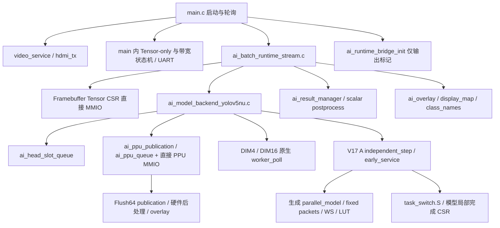

# SW Runtime R0 基线与约束

状态：R0 已完成基线审计与离线验证；两个现有契约缺口已复现，尚未修改生产行为。
日期：2026-10-13。代码基线：`fde62da83c3d061cd4e20dd8b9847891cba9307e`。
工作分支：`refactor/sw-runtime-r0`。设计：[分层重构方案](sw-runtime-refactor.md)。

开始 R0 时，HEAD 与设计基线一致；工作区只有此前归档的设计文档与导航改动。
本阶段新增测试、快照工具和文档，`sw/src/`、模型、`sw/Makefile`、硬件及既有固件构建脚本均保持基线内容。
本文记录实际代码行为，目标架构中更严格的所有权要求不能当作现有实现已经满足。

## 1. 环境、构建和冻结产物

| 项目 | 本次环境 |
| --- | --- |
| Host | Linux 6.8.0-110-generic / x86_64 / glibc 2.35 |
| Python / Make / Host GCC | 3.13.13 / 4.4.1 / 11.4.0 |
| RISC-V ELF / Linux GCC | 均为 13.2.0，`rv64gcv` / `lp64d` / `medany` |
| QEMU | 10.1.50，真实 RISC-V 测试使用 RVV VLEN256 |
| 工具路径 | 从根 Makefile / `tools/config/tools.local.mk` 读取 |
| 板上 UART、数值、连续视频及性能 | NOT_RUN |
| 整机综合、布局布线及位流生成 | NOT_RUN |

运行 `make runtime-baseline` 可重新采集，输出位于
`build/runtime-refactor/r0/<UTC时间戳>/`，不会下载开发板或启动 Vivado 构建。
本次最终证据目录：`build/runtime-refactor/r0/20261013T013114071800Z/`。

- `summary.json`：命令、状态、日志哈希、工具版本及独立的已知失败项。
- `source-inventory.json`：主要软件文件行数、SHA-256 和直接 include 列表。
- `build-configurations.json`：三种视频固件及基准的实际 Make 变量、源/对象列表、编译及链接参数。
- `artifacts/<配置>/`：ELF、`.map`、反汇编、生成包清单、配置 stamp 与逐依赖哈希。
- `logs/`：本次执行结果，不复用历史通过日志。

构建按现有入口进行增量构建，保存当次入口生成的产物；不宣称做了清缓存构建，
也不宣称不同机器的 debug ELF 必然字节一致。ELF 哈希及命令索引另存于
[本次 R0 验证记录](../validation/sw-runtime-r0.json)。全部生成产物留在忽略的 `build/`。

| 变体 | worker / DIM | local C / board C / vendor C / 链接对象 | 模型路径与编译差异 |
| --- | --- | --- | --- |
| dual16 | 2 / 16 | 25 / 2 / 30 / 59 | `runtime/yolov5nu_dim16_dual.c`，FP32 旧 ABI，credit admission=1 |
| single4 | 1 / 4 | 25 / 2 / 30 / 59 | 同一旧模型，独立 DIM4 参数头，Runtime timeout=300 s |
| triple32_v3_tensor | 3 / 32 | 24 / 2 / 30 / 60 | V17 A 生成模型 + independent + task_switch；不链接旧 selftest |

共同使用 `sw/linker_ai_video.ld`、静态内存、`--wrap=malloc/free`；本地普通 C 为
`-Os -Wall -Wextra -Werror`，模型为 `-O2` 并保留现有模型告警豁免。
V17 A 核心采用 `-O2`、light context、fixed policy、单包、200 µs、hot paths、
fixed plans/packets、prepared WS/LUT、idle priority、tail wait；credit admission=0，
PPU head clean=1，Class0 admit=0。只有两个 PPU 驱动对象启用 ordered MMIO。
基准使用单独的 `triple32/linker.ld`、三图输入及独立 PPU 数值对比程序。

## 2. 当前依赖及调用图

这是按源码人工确认的调用图；自动 inventory 只提取直接 include，不把文本扫描当作
预处理后的精确调用图。实际参与各变体的编译依赖另由 `.d` 快照证明。

| 文件/域 | 当前职责和数据 | R0 行数/接口事实 |
| --- | --- | --- |
| `main.c` | 初始化、CLI、模式互斥、带宽和 Tensor-only 服务 | 843 行；仍直接写 Tensor CSR |
| `ai_batch_runtime_stream.c` | 读描述符、latest/EDF、held、worker/post、TTL、overlay、drain/fault | 992 行；私有 `StreamRuntime` 统管生命周期 |
| `ai_model_backend_yolov5nu.c` | 模型推进、Head queue、PPU 发布及结果记录 | 819 行；计算和最终结果为两个 API |
| `ai_head_slot_queue.*` | 六槽软件状态及完整帧身份 | FREE/WRITING/READY/PROCESSING；generation 另由 publication 驱动保存 |
| `ai_tensor_slot_pool.*` | 通用软件分配器及类型 | `begin_write` 扫描任意 FREE，真实 Runtime 只使用类型/常量，未调用此分配器 |
| `ai_result_manager.*` | per-stream latest、过期去重 | 比较 frame，frame 相同时比较 version；不计算模型 |
| `ai_overlay.*` | CPU 框转换及标签 MMIO | hardware-overlay 结果直接返回成功，不从 metadata-only 结果重画框 |
| `ai_runtime_bridge.*` | 占位输出 | init 打印 `AI_STAGE runtime_init`，step 未接入主轮询 |
| `triple32/independent.c` | 协作任务、WAITING 证明、栈、预算 | 532 行；模型包内私有执行调度，持续池不与 Frame EDF 混用 |
| `triple32/model.c` 与生成器 | AOT、固定包及局部完成 CSR | 167 stage、58 普通卷积 stage；模型/汇编/source lock 暂留原位 |
| `ai_postprocess_scalar.c` | CPU fallback 解码及 NMS | Runtime 收到非 CUSTOM 输出时调用；V17 A 提交要求硬件 PPU/queue/publication 存在 |

启动顺序实际为 console → video_service_init → tensor_production_init →
ai_batch_runtime_init → bridge 标记 → help。循环顺序为 video_poll → runtime_poll →
带宽服务 → Tensor-only 服务 → write-only 服务 → UART。R5 才整理 App。

### 每次 Runtime poll 的可观察顺序

1. READY 快照及等待时间记录。
2. 按 worker 编号推进计算；先处理 `release_pending`，再调 `poll_compute`。
3. 计算完成身份校验 → 建立 post job → release Tensor 确认 → 清 held/worker。
4. **立即重新 dispatch，再进入 result polling**，保留计算/PPU 重叠窗口。
5. 收集最终结果，匹配 post job 和输出身份，publish/de-duplicate，完成 stream job。
6. TTL → overlay → drain/fault 处理 → stale slot 回收 → dispatch。

初始 job ID 为 `(1ULL << 60) + 1`。同 stream 的 `inflight_count` 跨越计算和 PPU，
直到最终结果/对应错误完成才递减。释放 worker 不代表允许同 stream 再次派发。
EDF deadline 为成功最终完成时的 `now + SOC_CLOCK_HZ/30`；同 deadline 选较大 frame。
版本仍以普通 `<=` 比较。TTL 仅在推理禁用后生效，运行中保留最新结果。

V17 A 的每个活动 worker `poll_compute()` 会执行一次全局 `independent_step()`，
并服务 Head/PPU。R0 保留调用次数；集中 progress 是 R4/R6 的后续独立改变。
`ai_batch_runtime_context()` 当前恒返回空指针，是旧批处理兼容占位，不是活动 job 查询。

## 3. 软件身份与 ABI 不变清单

`job_id`、Tensor `version`、Head `generation` 分别属于不同域。
Tensor HAL 从硬件读取 state/stream/frame/timestamp/version，Runtime 的 held/owner
属于软件域，不能把通用软件槽池的 generation 当作 Head 的硬件 generation。

| 类型 | RV64 字节数 | 关键偏移 |
| --- | --- | --- |
| AiModelFrameRequest | 72 | version=32，input_addr=40，output_addr=56 |
| AiFrameProfile | 104 | 13 个 uint64 字段 |
| AiModelComputeCompletion | 144 | profile=40 |
| AiModelFrameCompletion | 192 | output_addr=144 |
| AiTensorDesc | 36 | enum/维度/量化字段保持原布局 |
| AiHeadSlotDescriptor | 96 | base_addr=40 |
| AiHeadSlot / AiTensorSlot | 112 / 48 | 保留原兼容类型 |

`test_runtime_abi_baseline.c` 在 Host 和 RV64/LP64D QEMU 下检查这些布局，覆盖
worker=1/2/3。它检查现有类型 ABI，尚未定义新的 `Rt*` 类型。

### 地址、容量与顺序契约

| 资源 | 地址/配置 | 拥有者与不变条件 |
| --- | --- | --- |
| Framebuffer/Tensor CSR | `0x10140000` | 视频/Tensor 设备；Runtime 与 main 诊断当前均访问 |
| Tensor arenas | `0x30000000` / `0x31000000`，stride=921600 | stream s 固定槽 s 与 s+16；共 32 槽 |
| Tensor metadata | frame 32 bit，timestamp 64 bit，version 32 bit | version=0 不被 read_slot 接纳；API frame 字段为 64 bit，但硬件此入口只有 32 bit |
| CPU DDR alias | physical OR `0x80000000` | Tensor/Head 地址按现有 coherent alias 转换 |
| Head slots | `0x32000000/0x32100000/0x32400000/0x32500000/0x32800000/0x32900000` | worker0/1/2 各两槽，stride=1 MiB，payload=907200 |
| 六个 Head offset | `0/5dc00/75300/7b0c0/c60c0/d8cc0`（十六进制） | class0/1/2、DFL0/1/2，边界均 64B 对齐 |
| PPU MMIO | `0x10170000` | 后端持有事务；两个独立驱动负责 publication/queue |
| L2 Flush64 | `0x02010200`，uint64 写入对齐行地址 | CPU fallback cache_flush_range，两个 fence；与 PPU clean 分开 |
| TensorIngress snapshot | `0x02012000` | 诊断 `g`，snapshot 后读稳定 64-bit 计数；使用原 iorw fence |
| V3 内存计数器 | `0x02020000` | MPV3，观测用途；R0 不改 CSR/硬件 |
| V17 A opcode/CSR | custom3/2/1；busy=`7c2/7c3/7ca` | status=`7c4/7c5/7cb`，accepted=`7c6/7c8/7cc`，retired=`7c7/7c9/7cd` |

默认 Runtime admission mask 为 `CAMERA_PRESENT_MASK=0x00ff`，limit=1；
结构支持 16 路不等于默认启用 16 路，更不等于已验证 16×30 FPS。

Tensor 访问顺序保持：INDEX `+0x2e4` → fence → settle 1000 cycles →
VERSION → TIME_LO/HI → FRAME → BYTES → STREAM → ADDR → STATE → ERROR_CODE →
VERSION → READY。两次 version 相同且非零、stream/address/bytes/state/READY 一致才接纳。
READY/WRITING/ERROR 分别为 `+0x2d8/2dc/2e0`，metadata 为 `+0x2e8/2ec/328..340`。

释放顺序保持：等待 CONTROL `+0x2d0` 的 RELEASE_GO=0 → 写 RELEASE `+0x2d4`
位图 → fence → CONTROL=(当前 enabled?1:0)|2 → fence → 等待对应 READY/ERROR 位
以及 RELEASE_GO 均清零。单次等待 timeout=10,000,000 cycles（100 ms）。
Producer enable 保持 admission mask `+0x344`、limit `+0x348` → fence → CONTROL=1
→ fence → readback。drain 写 CONTROL=0；继续推进旧任务并释放非 held READY。
当前 idle 判定检查 enabled/draining/held/post/backend/worker/READY/WRITING，**不要求 ERROR=0**；
ERROR 清理由下一次 enable 路径处理。R1 不应悄悄把目标状态定义覆盖成新的行为。

Publication：magic `+0x1a0=50505532`；enable `1a4`、bank `1a8`、generation `1ac`、
command `1b0`、status `1b4`、masks `1b8`、hardware generation `1bc`。
BEGIN 读取旧 generation+1，写 command=1，经屏障后确认 allocation 和 generation；
PUBLISH 选择 bank/generation → 屏障 → 写 `(mask&63)<<8`。
V17 A 后端再确认 allocation/error/generation 及 producer mask receipt，timeout=1,000,000 cycles。
该 receipt 不是 cache clean 已完成，ready mask 与 producer mask 不能互换。

Queue：magic `+0x238=50505232`；enable `200`、GO `204`、ready `208.bit5`；
class 地址 `104/108/10c`、DFL 地址 `110/114/118`；stream/frame_lo/hi/version 为
`20c/210/214/218`。expect 写 `234=1`；提交写地址和元数据、`21c=0` → 屏障 → `204=1`。
结果 valid `240.bit0`；bank `250`，packed count/stream/status `254`，frame `258/25c`，
version `260`，cycles `264`，generation `268`；身份和软件 PROCESSING 状态匹配后才 pop `24c=1`。
CPU 输出为 CUSTOM AiDetectionResult，V17 A 可只有 metadata 与 hardware-overlay 标志。

普通 MMIO 保持原 `fence`；V17 A publication/queue 两个对象把该屏障替换为 uncached
PPU magic readback，编译器 memory barrier 包围读取。不能将这个特殊规则扩展到其他驱动。
Tensor B/READY 表示 L2 一致性完成而非 DDR 已写回；不引入统一 flush/invalidate。
Overlay CPU 提交保持 BUSY 检查、stream/count/boxes/labels → COMMIT；TTL 归结果策略层。

## 4. 可复现的身份转换与已知失败

[backend-identity.trace](../../tests/data/runtime/r0/backend-identity.trace) 使用生产后端、
Head queue 和 PPU 驱动，设备及模型为已有 Test Double；不是 Gemmini 数值仿真或板上 UART。
它确认以下顺序及完整身份：

| 事件 | job / worker / stream / frame / version | bank / generation | 所有权 |
| --- | --- | --- | --- |
| SUBMIT | 4097 / 2 / 11 / 4294967397 / 7 | 4 / 1 | input/activation/Head 持有 |
| HEADS_PUBLISHED_NO_ADMISSION | 同上 | 4 / 1 | 六个 Head receipt 齐备仍未入队 |
| COMPUTE_DONE_HEAD_HELD | 同上 | 4 / 1 | worker 已释放，Head 仍由 PPU 持有 |
| NEXT_STREAM_SUBMIT | 4098 / 2 / 12 / 4294967398 / 8 | 5 / 1 | 同 worker 开始不同 stream |
| HEAD_BACKPRESSURE | 4099 / 2 / 13 / 4294967399 / 9 | 待复用 4 | 两槽均持有，submit=-3 |
| RESULT_DONE_HEAD_RELEASED | 第一帧身份 | 4 / 1 | PPU pop，槽可复用 |
| BANK_REUSED | 第三帧身份 | 4 / 2 | 独立 generation 递增 |
| RESULT_DONE → LATE_RESULT_DONE | 第三帧 → 第二帧 | 4/2 → 5/1 | 后完成结果可先上报，身份不串帧 |

Tensor release 和同 stream 在途限制由原 stream Runtime 测试覆盖；上述后端 trace
不声称模拟了真实 Tensor DMA。错误 generation 另一个进程用同样驱动复现，结果不 pop，
新 submit 被 fault 拦截，Head 保持占有。

| 编号 | 已确认现状 | 判定/证据 | 后续归属 |
| --- | --- | --- | --- |
| R0-GAP-01 | abort=-2 标 ERROR；下一次 poll_compute 清 running 并返回 -2；再次 abort=0，但模型/task double 仍持有且未完成 | 停止证明契约 FAIL；`abort-gap` + 生产 abort/error 分支 | R2 安全回收；先改为未知事务仍保留所有权，独立回归 |
| R0-GAP-02 | 完成 frame100/version UINT32_MAX 后，新 frame101/version1 被 `<=` 比较回收为 stale | 回绕正确性 FAIL；生产 Runtime + 原 Fake CSR | 单独版本协议变更，不能混进等价 HAL 抽离 |

R0-GAP-01 证明当前 abort 返回值不保证计算已经停止；测试不模拟实际 DMA，
不宣称已在板上观测到数据覆盖。Runtime 目前把 abort=0 用作输入释放许可，
所以该缺口必须在资源/错误路径阶段正面处理。

两个 reproducer **有意对现有缺口做 characterization**，故测试进程返回成功；
记录工具仍单独写 `safety_invariants[].status=FAIL`，并输出 `R0_SAFETY_PASSED=0`。
通过构建/回归不等于通过这两个目标契约；未来修复时应替换对应预期和 trace。

其他审计事项：V17 A 外层 Runtime timeout 默认 50 s，而内部 task timeout 为 600 s；
单4外层为 300 s。不得把这些数字当作同一 watchdog。CPU fallback 的 capability/banner
和 ERROR-only idle 行为需要后续受控接口表达，当前保留。主机 Runtime 运行测试覆盖
2/3 worker，1 worker 本次有构建和 ABI 验证，尚没有同等的完整 fake-pipeline 回归。

多 stream 同时双 READY 的交错尚未覆盖：`service_stale_slots` 每轮只回收一个槽，
`dispatch_jobs` 对仍为双 READY 的 stream 优先取 s+16，并未在该函数比较两槽版本。
R1 保留这个实际顺序；R3 应补多 stream 双槽轨迹，不能以 latest-frame 的目标描述
替代所有交错均已验证的结论。

## 5. UART 基线矩阵

[uart-literals.json](../../tests/data/runtime/r0/uart-literals.json) 记录上述四个生产源文件的
109 个原始 console_puts 字面量及源位置，类型明确为 source catalog，不冒充实测日志。
板上成功、超时、重启 UART 捕获本次均 NOT_RUN。

| 命令 | 原有行为/门槛 | 需保留的输出或效果 |
| --- | --- | --- |
| i | enable 或 drain；Tensor-only 与 AI 互斥 | `AI stream runtime enabled` / `AI stream runtime draining` |
| s / v | Runtime / HDMI 状态，读取计数 | 保留身份/阶段/计数含义；不能触发资源释放 |
| p | AI disabled 且 idle 后输出 frame profile | `disable AI and wait for drain first` |
| P | PPU 观测/阶段统计 | 保持硬件诊断，不重置 graph |
| m | Tensor-only toggle/drain；与 AI/带宽互斥 | `TENSOR PROD enabled...`；活动时只允许 g/m/s/h |
| g | 仅编译 TENSOR_INGRESS_STATS 时可用 | snapshot/重复读取带宽；V3 构建启用，默认旧变体未启用 |
| t / u / U / T | 必须 AI/Tensor/带宽 idle | 旧变体执行 selftest，V17 A 明确提示使用独立基准 ELF |
| b | AI 并发带宽 | AI 必须已启动；独立服务状态机 |
| R / W / C | read-only / write-only / raw-concurrent 带宽 | 保留 admission 保存/恢复、互斥和 drain |
| o | overlay pattern | `OVERLAY TEST: CH1-CH16 boxes submitted` 或失败 |
| r | 只重启 HDMI/video | 不清除 Runtime fault、版本或 Head 所有权 |
| c / h / ? | 时钟 ID / 帮助 | 诊断，不改变 AI 模式 |

## 6. 本次验证与 R1 入口

最终采集共 15 个命令条目，均 PASS；没有 SKIP/BLOCKED。包括 manifests、dependencies、
Runtime host、全部 host（含新增 R0 测试）、101 项 V17 A、三图基准、三变体 ELF、
V17 A ELF audit 和两个 reproducer。RV64 ABI 与真实 live light context 均运行通过。
两个上述目标契约依旧 FAIL，板测及数值吞吐为 NOT_RUN。完整命令索引见验证 JSON。

### R1a 最小变更：先只抽 Tensor 设备边界

| 文件 | 最小改动 |
| --- | --- |
| 新 `sw/src/drivers/tensor/ai_tensor_device.h/.c` | 不带 owner 的纯设备描述符、ready/error/writing、read metadata、release、producer enable/control；沿用准确访问顺序、超时和返回语义 |
| `sw/src/ai/runtime/ai_batch_runtime_stream.c` | 原 private helper 委托设备接口；enabled、held、EDF、post、TTL、fault 策略全部留原位；idle/drain 的直接 CSR 访问一并委托 |
| `sw/Makefile` | 增加同一 HAL source；三种 ABI/model 选择不变 |
| `tests/host/run_ai_batch_runtime_stream_test.sh` | 链接新设备源，继续调用原 public API 与 Fake CSR |
| 新 `tests/host/test_ai_tensor_device.c` 和 runner | Fake CSR 读写序列、INDEX settle、version 不稳、READY 消失、错误地址/长度/stream、release 延迟/失败、enable readback |
| 本基线及阶段报告 | 记录 API、旧/新 MMIO trace 对照和回退点 |

不得用通用 AiTensorSlotPool 替代真实每路双槽。release 要显式传入原 enabled 状态，
不能引入 HAL 自己的 Runtime 状态。BUSY/ERROR 的映射先兼容旧 -1/0，策略改变另交付。

回归集：`make test-runtime-baseline test-runtime test-software test-v17a`、三种 firmware、
`make firmware-benchmark check-v17a-firmware check-deps`；Tensor 协议适配按需增加
`make test-tensor-ingress test-tensor`。R0-GAP-01/02 的 characterization 在等价 R1a 中
应保持，不能在测试中静默改成已修复。MMIO trace 需比对读写顺序及 fence/settle 位置。

R1b 再封装 PPU 的寄存器/receipt/结果读取，保留两个对象专用 ordered MMIO；
R1c 梳理 overlay/cache 设备接口。每次只移动一个边界，最后才能按设计签收完整 R1。
R2 的 abort 修复与版本协议变更必须有各自明确的行为变更记录。

回退：本阶段只有 docs、tests、Make 测试入口和采集工具；撤回 R0 提交不改变生产推理。
R1a 使用兼容 wrapper，独立提交后可整体 revert；冻结的 source lock、模型、汇编和
硬件 ABI 不作为目录搬迁目标。本次按设计 §9.2 只完成 R0，R1–R6 尚未实施。
