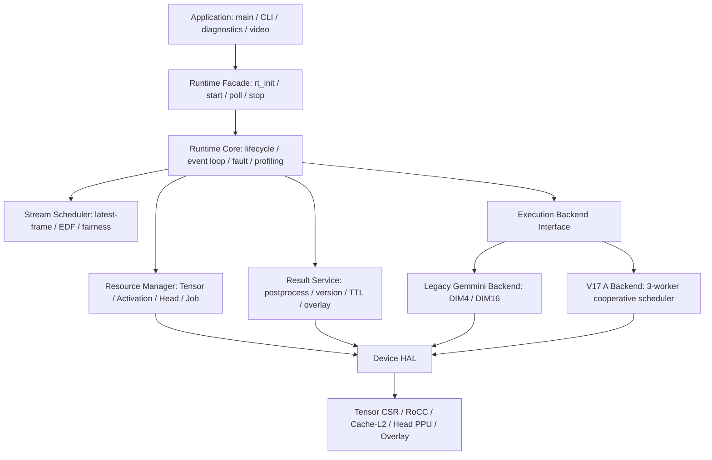
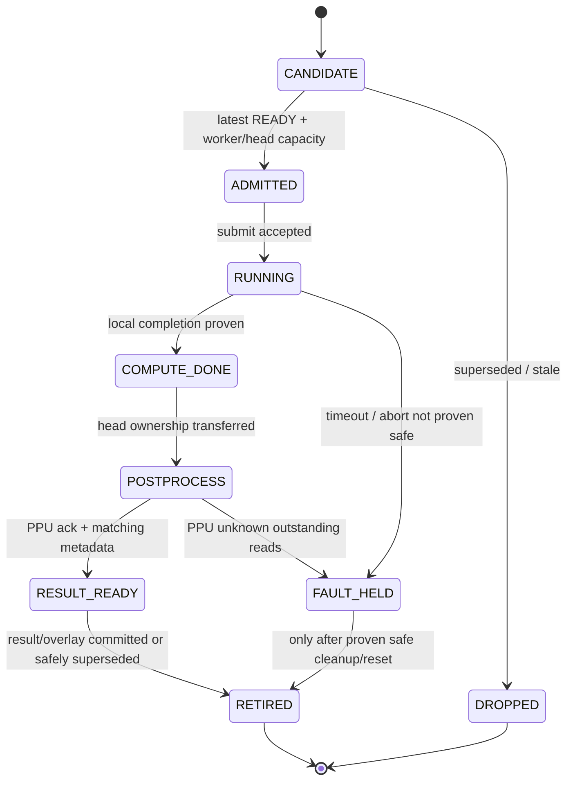

# sixteen_camera — SW Runtime 分层重构设计与实施方案

> **状态**：分阶段实施中（R0、R1 已完成离线验证；板测待验证）
> **编写日期**：2026-10-12  
> **仓库**：[Cc-aw/sixteen_camera](https://github.com/Cc-aw/sixteen_camera)  
> **审查基线**：`main` @ [`fde62da83c3d061cd4e20dd8b9847891cba9307e`](https://github.com/Cc-aw/sixteen_camera/commit/fde62da83c3d061cd4e20dd8b9847891cba9307e)  
> **影响范围**：优先修改 `sw/`、`tests/host/`、必要的 `tools/build/` 与 `docs/`；不修改硬件设计和寄存器协议。  
> **目标读者**：负责裸机 RISC-V / Gemmini / V17 A 软件重构的开发者及 Codex Agent。

**实施进度（2026-10-13）**：R0 已完成离线基线与契约审计，见 [基线与约束](sw-runtime-baseline.md)。R1a Tensor、R1b PPU、R1c overlay/cache 设备边界已完成，见 [R1a](sw-runtime-r1a.md)、[R1b](sw-runtime-r1b.md)、[R1c 与完整 R1 离线验收](sw-runtime-r1c.md)。R2 资源身份与所有权已完成离线验收，见 [R2](sw-runtime-r2.md)：未确认停止的 abort/fault 保留资源，R0-GAP-01 已修复；Tensor version 回绕缺口仍待独立协议修复。R3 调度、Pipeline、服务与状态机已完成离线结构等价验收，见 [R3](sw-runtime-r3.md)，完整事件对照 47 组通过。板测未执行；R4–R6 尚未实施。按用户要求，R0/R1a 已快进合入 `main`，开发分支已删除，后续直接在 `main` 分阶段提交。

---

## 0. 执行摘要

将目前以 `main.c`、`ai_batch_runtime_stream.c`、`ai_model_backend_yolov5nu.c` 为中心的软件组织方式，逐步重构为**可配置的嵌入式 AI 推理 Runtime**。新架构采用：

1. **Application**：启动、命令行、视频业务和诊断；
2. **Runtime Core / Pipeline**：运行状态、事件推进、任务生命周期；
3. **Stream Scheduler**：16 路视频的 Latest-frame、EDF 与准入控制；
4. **Resource Manager**：Tensor / Activation / Head 槽所有权与安全回收；
5. **Execution Backend**：Legacy Gemmini 与 V17 A 三 Worker 协作执行；
6. **Device HAL / Drivers**：Tensor CSR、PPU、Head publication、Overlay、缓存一致性与 MMIO；
7. **Model Package**：YOLOv5nu AOT 图、固定包、权重、算子实现及模型相关配置。

**第一性原则：分层但不改变当前推理语义。** 在完成回归和实际板测前，不应将「更模块化」等同于「更高 FPS」。此次先实现可验证的结构等价，随后通过独立优化阶段提升吞吐与 CPU 调度效率。

### 0.1 本次必须取得的结果

- `main.c` 只保留主程序装配和轻量事件循环，业务诊断移动到独立模块。
- Runtime 内核不直接包含 `mmio.h`，不直接拼装 CSR 地址。
- Frame Scheduler 与 V17 A 协作式 Execution Scheduler 成为**两个不同的调度域**。
- 所有 Tensor、Activation、Head 与 Result 生命周期由明确的状态机和所有权契约约束。
- `dual16`、`single4`、`triple32_v3_tensor` 由同一个上层 Runtime API 驱动，通过构建配置选择兼容的后端。
- 既有板级协议、AOT 数值计算路径、固定 RoCC 包、PPU 发布时序和 cache/coherence 规则不发生隐式变化。
- 每个重构阶段均可单独回归、审查、回退，不允许一次性大搬迁后再找问题。

### 0.2 本次明确不包含

- 不修改 SystemVerilog、SoC 生成 Scala、L2/NoC、TensorIngress、PPU RTL 和 MMIO 地址映射。
- 不增加 RTOS、线程池、中断抢占调度或动态堆分配。
- 不重写 Stage8F AOT、V17 A 固定计划/固定指令包，也不改变 YOLOv5nu 网络和量化规则。
- 不以重构之名同步替换 EDF 算法、延迟策略、帧丢弃策略或 Worker 内部 packet policy。
- 不承诺当前固件已经实现 16 路 × 30 FPS；性能优化和板上闭环另行验收。
- 不将旧 SoC 固件 ABI 与 `triple32_v3_tensor` 的 ABI 混用。

---

## 1. 当前仓库基线与存在的问题

### 1.1 配置与执行链路

| 配置 | CPU/执行 | Gemmini | 当前软件形态 | 注意事项 |
|---|---|---|---|---|
| `dual16` | 裸机 RISC-V | 2 × DIM16 | Legacy 合作式模型执行 | 使用旧 Gemmini ABI，保留既有诊断 |
| `single4` | 裸机 RISC-V | 1 × DIM4 | Legacy 模型执行 | 单 Worker，超时参数不同 |
| `triple32_v3_tensor` | 1 Rocket + 1 RVV | 3 × DIM32 @ 100 MHz | V17 A：light context、固定包、单包提交、200 µs 时间量子 | V3 L2 / TensorIngress、独立 V17 A 生成/固件 ABI |

> **关键变化**：仓库当前最新三路硬件是 `triple32_v3_tensor` 的 **3 × Gemmini32**，不是旧计划中的 3 × Gemmini64。Runtime 设计应支持可变 Worker 数与后端能力，但不能假定不同 DIM 使用同一二进制指令 ABI。

物理视频链路：8 路 OV7670 + 4K30 HDMI 空间解复用 8 路 → 16 路 640×480；AI 链路：硬件 RGB INT8 Tensor Producer → Tensor 槽 → Gemmini/RVV → 六个 Raw Head → 硬件 PPU → Result / Overlay。

### 1.2 已观察到的结构性耦合

| 现有源码 | 主要问题 | 目标边界 |
|---|---|---|
| `sw/src/main.c` | UART 命令、带宽压力测试、Tensor-only 测试、业务状态互斥与主轮询混杂 | `app/` + `diagnostics/` |
| `sw/src/ai/runtime/ai_batch_runtime_stream.c` | 直接操作 Tensor CSR，又实现 EDF、Worker 管理、Post Job、TTL、Overlay 和统计 | `drivers/tensor` + `runtime/scheduler` + `runtime/core` + `runtime/services` |
| `sw/src/ai/runtime/ai_tensor_slot_pool.c` | 存在用于软件测试/通用分配的槽池，实现模型不同于真实硬件每路固定双槽映射 | 统一槽协议；真实后端以硬件状态为真相 |
| `sw/src/ai/backend/ai_model_backend_yolov5nu.c` | YOLO 执行、Head Slot、PPU MMIO、Head publication、结果完成事件互相依赖 | `backends/gemmini` + `runtime/resources` + `drivers/ppu` |
| `sw/models/yolov5nu/triple32/independent.c` | V17 A 任务切换、局部完成证明、协作式调度由模型实现持有 | 暂保留为 V17 A Execution Backend 内部模块 |
| `sw/src/ai/runtime/ai_runtime_bridge.c` | 目前只是输出 `AI_STAGE` 的占位入口，并非真实抽象层 | 最终替换为公开 Runtime Facade |
| `sw/src/platform/platform.h` | 固定板级地址、Buffer 布局和业务常量混合定义 | 保留原有 ABI，逐步建立只读配置/能力边界 |

### 1.3 不能忽略的当前实现细节

- **16 路、32 个 Tensor 槽**：真实硬件为每路 2 槽，编号 `stream` 与 `stream + 16`；不是全局任意槽分配。
- **Head Pool**：最多 3 Worker，每 Worker 2 槽，共 6 个 1 MiB Head 槽；Head 由 PPU 消费完成后才可复用。
- **Compute ≠ Result 完成**：`poll_compute()` 可释放 Worker/Activation/输入，`poll_result()` 负责之后的 PPU/结果阶段。
- **单路在途限制**：现有 `inflight_count` 跨越计算和后处理阶段；允许释放 Worker，但未完成最终结果前不应让同一路重复进入执行。
- **旧版本与 V17 A 的 PPU Admission 不同**：Legacy 路径可能在 Class0 事件时提前 admit；V17 A 当前策略禁止 Class0 提前入队，需等待六个 Head 与完整计算证明。
- **时间语义**：当前 `next_deadline` 基于上次任务完整完成时间加 33.333 ms；它是当前调度行为，不等于严格基于捕获时间的绝对 EDF。第一轮不改变。
- **TTL**：当前运行中保留最新检测结果，禁用推理后才使用 1 s TTL 清除过时 Overlay；不能误改成运行中一秒无新结果即清框。
- **最新结果格式**：V17 A 可返回 `AI_RESULT_HARDWARE_OVERLAY | AI_RESULT_METADATA_ONLY`，不要求 CPU 得到完整的检测框数组。

### 1.4 真实 Tensor/缓存契约

最新 TensorIngress 使用专用 AXI/TL 写入口，完整 64B 行写以 `PutFullData(size=6)` 进入 L2。**READY 在该帧全部成功 B 响应后才发布，B 代表 L2 一致性确认，不保证 DDR 已写回。** 推理侧必须遵守同一地址别名、完成证明及 Cache/Flush64 契约，不能把某个传统 DMA API 的统一 `flush/invalidate` 逻辑直接替代原路径。

另外，V17 A PPU 两个专用驱动启用有序 uncached MMIO 读回屏障，避免使用全局 RoCC fence。任何 HAL 封装都必须保留已验证的访问顺序与屏障位置。

---

## 2. Runtime 目标架构



### 2.1 单向依赖规则

1. `app/` 只使用 Runtime 公开 API 和显式诊断/视频接口；不得直接触碰推理 Worker/Head 内部状态。
2. `runtime/core/` 依赖 Scheduler、Resource、Backend API、Service API；不包含硬件 CSR 寄存器细节。
3. `runtime/scheduler/` 只处理**纯输入快照、策略和决策**；不直接调用 `mmio_read32()` 或 `gemmini_*()`。
4. `runtime/resources/` 是**软件所有权的唯一管理点**；真实 Tensor 设备 READY/WRITING/ERROR 位与版本来自 HAL，不可伪造一套独立的生产者状态。
5. `backends/` 实现计算执行和后端事件；V17 A 内部的上下文切换、包提交是其私有逻辑，上层不解析单条 RoCC 指令。
6. `drivers/` / `platform/` 封装 MMIO、Cache、地址映射及硬件协议，不含 EDF、任务公平性或 YOLO 检测业务策略。
7. `models/` 维护模型图、参数、权重与模型专用 Head Layout；通用 Runtime 不使用模型文件名推断内存协议。
8. `diagnostics/` 不应修改生产流式 Runtime 的内部私有变量；需要诊断模式时，必须通过受控状态转换切换。

### 2.2 两级调度（必须分离）

| 调度域 | 输入 | 选择结果 | 拥有者 | 允许更换策略 |
|---|---|---|---|---|
| **Level 1 — Frame Scheduler** | 16 路 Ready Snapshot、Stream deadline、Worker 空闲、Head 背压 | `(stream_id, slot_handle, worker_id)` | `runtime/scheduler/` | 是；但首版保持原有行为 |
| **Level 2 — Execution Scheduler** | V17 A 协作任务状态、RoCC accepted/retired、WAITING、包量子 | 下一次恢复/提交的模型任务或返回调用方 | `backends/gemmini/v17a/` | 本次否；后续独立性能优化 |

上层分配“哪一帧去哪个逻辑 Worker”；下层决定“这个 Worker 的模型如何在单 Rocket CPU + 多 Gemmini 中推进”。下层允许全部 WAITING 时立即返回外层循环，不能在 CPU 内无限空转等待设备。

### 2.3 推荐源码结构（渐进目标）

> **先创建接口与适配层，后迁移文件。** 不强制在 R1 一次性移动所有源文件；为了兼容现有构建脚本与测试，允许旧路径以过渡 shim 形式保留。

```text
sw/
├── src/
│   ├── main.c                         # R5：仅启动与主循环
│   ├── app/
│   │   ├── app.c                      # 系统编排
│   │   ├── command.c                  # UART / CLI
│   │   └── mode_manager.c             # 推理 / tensor-only / 带宽测试互斥
│   ├── runtime/
│   │   ├── rt.h                       # 唯一公开 Facade
│   │   ├── rt_types.h
│   │   ├── rt_config.h
│   │   ├── core/
│   │   │   ├── rt_core.c
│   │   │   ├── rt_pipeline.c
│   │   │   ├── rt_job.c
│   │   │   ├── rt_events.c
│   │   │   └── rt_stats.c
│   │   ├── scheduler/
│   │   │   ├── rt_frame_scheduler.c
│   │   │   └── rt_worker_dispatch.c
│   │   ├── resources/
│   │   │   ├── rt_tensor_manager.c
│   │   │   ├── rt_head_manager.c
│   │   │   └── rt_arena_manager.c
│   │   └── services/
│   │       ├── rt_postprocess_service.c
│   │       ├── rt_result_service.c
│   │       └── rt_overlay_service.c
│   ├── backends/
│   │   ├── rt_backend.h
│   │   └── gemmini/
│   │       ├── legacy/                # DIM4 / DIM16 adapter
│   │       └── v17a/                  # DIM32 / V17 A adapter
│   ├── drivers/
│   │   ├── tensor/                    # READY/WRITING/ERROR、描述符、release
│   │   ├── ppu/                       # 描述符提交 / publication / completion
│   │   ├── overlay/                   # 显示 MMIO
│   │   └── cache/                     # Coherence/Flush64 适配
│   ├── video/                         # 保持原实现及初始化顺序
│   ├── board/                         # 保持原板级驱动
│   ├── platform/                      # 时钟、MMIO、CSR、启动代码
│   └── diagnostics/                   # 自测 / 带宽 / profile
├── models/yolov5nu/                  # AOT、生成器、冻结输入暂不迁移
├── third_party/                       # 不修改供应商快照
├── Makefile
└── linker_ai_video.ld
```

`backends/gemmini/v17a/` 可先使用适配文件链接现有 `models/yolov5nu/triple32/{independent.c,task_switch.S,...}`，避免直接移动这些与生成器/快照哈希相关的源码。设计完成后再评估是否迁移。

---

## 3. 统一公开 API 与数据模型

### 3.1 Runtime Facade（目标接口示意，不应一次性机械替换旧 ABI）

```c
/* sw/src/runtime/rt.h — conceptual interface */

typedef struct RtConfig RtConfig;
typedef struct RtStats RtStats;

typedef enum {
    RT_STOPPED = 0,
    RT_RUNNING,
    RT_DRAINING,
    RT_FAULTED
} RtState;

typedef enum {
    RT_STATUS_OK = 0,
    RT_STATUS_PENDING = 1,
    RT_STATUS_BUSY = 2,
    RT_STATUS_INVALID = -1,
    RT_STATUS_IO_ERROR = -2,
    RT_STATUS_FATAL = -3
} RtStatus;

RtStatus rt_init(const RtConfig *config);
RtStatus rt_start(void);
RtStatus rt_stop(void);               /* initiate graceful drain */
void     rt_poll(uint64_t budget_cycles);
RtState  rt_state(void);
bool     rt_is_idle(void);
void     rt_get_stats(RtStats *stats);
```

**注意**：现有 `read_slot()` 和 `release_slot()` 含同步等待与超时轮询。R1–R5 可以暂保留这些硬件操作的同步语义。此时 `budget_cycles` 只能视为上层循环的**软预算**，不能承诺严格的调用耗时上限。R6 完成非阻塞设备事务状态机后，才可进一步保证硬预算。

### 3.2 后端接口必须实现“推进一次、取出事件”

```c
/* sw/src/backends/rt_backend.h — conceptual interface */

typedef enum {
    RT_BACKEND_COMPUTE_DONE,
    RT_BACKEND_HEAD_READY,
    RT_BACKEND_RESULT_READY,
    RT_BACKEND_FAULT
} RtBackendEventType;

typedef struct {
    RtBackendEventType type;
    uint64_t job_id;
    uint32_t worker_id;
    uint32_t stream_id;
    uint64_t frame_id;
    uint32_t version;
    uint32_t head_mask;
    int32_t status;
} RtBackendEvent;

typedef struct {
    RtStatus (*init)(void);
    RtStatus (*submit)(const AiModelFrameRequest *req);
    void     (*progress)(uint64_t soft_budget_cycles);
    int      (*poll_event)(RtBackendEvent *event); /* 1/0/<0 */
    RtStatus (*abort)(uint32_t worker_id);
    bool     (*is_idle)(void);
} RtBackendOps;
```

- **V17 A 的 `progress()` 每轮集中推进协作调度器**，不要由外层遍历每个 Worker 时反复调用 `yolo32_independent_step()`。但是本次首步应先由兼容适配器完整转发原调用序列，验证后才能修改推进次数与事件收集方式。
- 模型的 Head 早期发布发生在模型生成回调/执行过程内部，必须保留 callback → publication/校验链，不能用 `COMPUTE_DONE` 事件完全替代。
- `HEAD_READY` 事件只代表已证明完成且满足对应 generation/mask 的部分生产结果，**不自动授权 PPU 提前消费**；具体 admit 门槛按构建配置保留。
- `abort()` 不能默认表示 DMA 已结束。只有拿到安全停止证明后，才能释放输入槽、Activation 和 Head。
- 后端可以用静态 `RtBackendOps` 表切换配置；高频 RoCC hot path 不应无谓增加函数指针/锁/heap 操作。

### 3.3 任务元数据：每一帧必须有完整身份

建议沿用现有 `AiModelFrameRequest` 的关键字段，形成统一 `RtJobId` / `RtFrameKey`：

```c
typedef struct {
    uint64_t job_id;
    uint32_t stream_id;
    uint64_t frame_id;
    uint32_t version;
    uint64_t capture_timestamp;
} RtFrameKey;

typedef struct {
    uint32_t index;
    uint32_t generation;
} RtSlotHandle;
```

软件 `job_id`、Tensor `version`、硬件 Head `generation` 代表不同身份域，不能混用。尤其 Head 由两个 ping-pong 槽复用，必须联合校验 `slot + generation + job/frame/stream/version`，不能仅凭某个 READY 位释放资源。

### 3.4 设备 API 应定义清楚“不可立即完成”

- `DEVICE_OK`：操作完成且条件已确认。
- `DEVICE_BUSY/AGAIN`：硬件资源或完成条件尚不满足，正常背压，非 Fault。
- `DEVICE_ERROR`：协议不匹配、非法地址、超时或硬件故障，需走受控错误路径。
- 用明确的结果枚举取代业务层对 `-3`（当前 Head Slot 满）等裸错误码的特殊处理，但迁移时必须有精确兼容映射。
- 纯调度模块不得使用底层设备的数值错误码判断是否重试。

---

## 4. Job、Tensor、Head 生命周期

### 4.1 Job 状态机



实现时可精简状态数量，但必须保留 **COMPUTE_DONE** 和 **RESULT_READY** 之间的边界，不允许把二者折叠为单次完成。

### 4.2 所有权转移矩阵

| 资源 | 生产/创建者 | 被谁持有 | 释放前置条件 | 禁止行为 |
|---|---|---|---|---|
| Tensor Slot | FPGA Tensor Producer | 被接纳的 Job/Worker | 本 Worker 已不再读取、相关 DMA 完成，HAL release 确认 | 未完成就重写；凭软件空闲位忽略硬件 READY |
| Activation Arena | Backend 的 Worker/模型 | 正在执行的 Worker | graph compute 已完成、不会再次访问该 Arena | PPU 完成误当成计算完成；复用中重置旧 worker |
| Head Slot | 模型输出/Head publication | Head Pool / PPU | 对应 generation 已消费、结果队列退役或安全 abort | 仅因 compute done 就复用；错误时强行释放 |
| Post Job | Runtime | Result Service | 结果事件消费、身份验证、错误/过期处理已完成 | 同一路提前重复接纳新 Job |
| Result/Overlay | PPU 或 CPU fallback | Result Manager / Overlay | 数据已复制或硬件拥有权完成交付 | 将 metadata-only 当作指向完整 boxes 的指针 |

### 4.3 Tensor 资源策略

真实 FPGA 路径应走下列顺序：

1. HAL 读取 READY/ERROR/WRITING 快照；
2. 对候选槽按照当前协议选择 `INDEX`，等待 metadata settle；
3. 先后两次读取 `version`，同时检查 stream、地址、字节数、READY 位与状态，得到稳定描述符；
4. Resource Manager 校验未被本 Runtime `held`，并提供 `RtSlotHandle`；
5. Frame Scheduler 从每路固定双槽中选择当前最新可用帧；
6. Backend `submit` 成功以后，Job 与 Tensor 槽建立持有关系；
7. Compute 完成并验证安全后，走 HAL release；未成功则保持 `RELEASE_PENDING/FAULT_HELD`；
8. 旧 READY 槽丢弃也必须等待硬件 release 确认。

现有 `ai_tensor_slot_pool.c` 的软件全局空闲槽选择策略与硬件固定 `(stream, stream+16)` 并不一致。它不能未经适配直接作为真实设备的唯一分配器。应：

- 为真实硬件采用**描述符 + held/owner 跟踪**的管理器；
- 为 Host 测试提供模拟 Tensor Device，复现每路固定双槽、硬件完成及 release 协议；
- 保留或迁移原软件槽池测试，但不得以它们通过作为硬件 Tensor 生命周期验证通过的充分条件。

### 4.4 Head / PPU 资源策略

- Head Pool 为每 Worker 2 槽。`WRITING -> READY -> PROCESSING -> FREE` 的现有资源转移必须保持。
- V17 A 要确认 accepted/retired 计数、ingress/outstanding、DMA busy、局部 Head 完成周期、Head request 数量、generation 与 producer mask。
- 早期 publication 仅在相应 Head **完成证明**成立后执行；V17 A 当前要求六个 Head mask 完整 (`0x3F`) 且 graph 完成证明齐备后才入队 PPU。
- PPU 队列出队时必须确认 bank、generation、stream、frame、version 与当前槽描述符一致；否则进入 Fault，而非把结果发到错误视频通道。
- PPU 读取出现超时/未知 outstanding 时，保留槽/reader 所有权直到明确安全的恢复或系统复位，绝不因超时直接 FREE。
- PPU 的结果可为 metadata-only。发布后由 Result Manager 比较版本和帧号，再决定 Overlay 更新或 stale 丢弃。

### 4.5 Drain 和 Fault 不能混为一谈

- `STOPPED`：没有活动 Job、Backend Idle、无 Tensor 正在写入、无待释放资源，且生产关闭。
- `RUNNING`：允许 Tensor 准入与派发。
- `DRAINING`：先关闭新生产与 Job 准入；继续推动计算/PPU 完成，逐项释放 READY、ERROR、held 槽；直到所有设备确认空闲。
- `FAULTED`：阻止新提交；仅执行**经过证明安全**的回收操作。对无法证明 DMA/PPU 已停止的资源维持占有，报告 Fault，必要时要求全局复位。不可为了显示空闲而假释放。

原有 `ai_batch_runtime_is_idle()` 不只是 `worker_active == 0`：还必须检查 Backend、Post Job、held、硬件 READY 和 WRITING。这一语义应保留并集中实现。

### 4.6 Version / 时间戳一致性

- 现有 `version` 为硬件流相关的 32 位字段，不能无限期依赖简单的 `<=` 比较。在本次结构迁移中先保持原比较行为，增加**回绕风险测试与问题记录**；若要改为序列号模运算，必须单独提交协议变更，并明确最大有效版本跨度。
- `frame_id`、`capture_timestamp`、`last_complete_cycle` 属于不同时间/身份域；采样端 SOF 时间、CPU 完成时间和 Job deadline 不得相互替代。
- 在出现过期结果、Result Queue 重排或 Head Generation 复用时，必须具备完整 identity 校验，保证旧任务不能污染较新 Stream Result。

---

## 5. 分阶段改造计划（R0–R6）

### R0 — 冻结基线和接口契约（第一优先级）

**任务**

1. 新建独立分支，例如 `refactor/sw-runtime-r0`；记录基线 commit、工具链版本、配置与主机/QEMU/板测环境。
2. 保存现有三个配置的 ELF、反汇编、构建参数和相关 `.map`/哈希；不把生成文件提交到 Git。
3. 统计主要 SW 文件、数据类型、宏配置、调用关系和 `sw/Makefile` 源列表。
4. 固定 `ai_batch_runtime_*`、`ai_model_backend_*` 及 V17 A API 的可观察行为；优先补 Test Double/MOCK，而不是先拆源码。
5. 制作基线 UART 命令矩阵（`i/s/v/p/P/m` 与诊断命令）、典型成功与错误日志快照。
6. 建立《Runtime 硬件 ABI 不变清单》：MMIO 地址/寄存器、Head 布局、Tensor 槽地址、Gemmini opcode、Flush64、PPU 队列/屏障。

**完成条件**：三变体至少完成可用环境下的固件构建、Host/V17 A 回归；板测不能运行时明确标记 `NOT_RUN`，不得视为 PASS。所有已知当前失败项记录为 baseline，而非后续归因于重构。

### R1 — Device HAL 抽离（不改调度）

**任务**

1. 创建 `drivers/tensor/`：从 `ai_batch_runtime_stream.c` 中抽离 `hardware_ready()`、`hardware_error()`、`read_slot()`、`release_slot()` 及 Producer enable/admission 配置。
2. 创建 `drivers/ppu/`：封装 `ai_ppu_queue.c`、`ai_ppu_publication.c` 中的 CSR 访问、描述符提交、完成读取和 generation 校验；首步保留原文件作为兼容层亦可。
3. 将 Overlay MMIO 与 Runtime 结果策略解耦：设备层只执行 draw/commit，结果版本排序留在 Result Service。
4. 集中 `cache_ops` 能力定义：CPU alias、数据可见性、Flush64、ordered PPU MMIO、RoCC/CPU fence 语义必须分别表达。
5. 为 HAL 建立 Host Fake CSR 测试：读写次序、metadata 版本前后校验、release ack、超时和重复释放。
6. 确保原文件调用 HAL 后行为不变，不修改旧超时数值及热路径中设备操作数量。

**完成条件**：业务 Runtime / Scheduler 不再直接拼装 Tensor/PPU MMIO；Host 模拟校验、固件编译与原测试通过；原读写顺序和屏障经代码比对无变化。

### R2 — Resource Manager / Job Identity（最关键）

**任务**

1. 建立 `rt_tensor_manager`：硬件固定双槽映射、Ready Snapshot、held/owner、release pending 和 descriptor identity。
2. 建立 `rt_head_manager`：Head `WRITING/READY/PROCESSING/FREE`、generation、producer mask、PPU ownership；初期可委托原 `ai_head_slot_queue`。
3. 建立 `rt_arena_manager`：将 Worker 独占的 activation arena 与 raw-head arena 分开描述。
4. 建立 `rt_job.c`：统一 `job_id/stream/frame/version` 身份、Job 状态、Worker 与 Post Job 的生命周期关联。
5. 将输入/激活释放与 Head 释放改成**两种独立事件**；不允许在同一个 `finish_worker()` 中清空全部资源。
6. 为所有权建立断言和可观测计数：`held_tensor`, `active_worker`, `pending_post`, `owned_head`, `release_retry`, `unsafe_fault`。
7. 特别补全 `error/abort/timeout/drain` 路径，保证相同槽不会两次释放、不发生未完成 DMA 重用。

**完成条件**：固定 32 Tensor / 6 Head 配置、不同 Worker 数、重复 generation、出错/延迟完成/错误释放的 Host 回归通过；旧路径行为等价。

### R3 — Stream Scheduler 与 Pipeline 拆分

**任务**

1. 将 `dispatch_jobs()` 拆分为**纯候选选择**（不读 MMIO）与**派发事务**（Worker/Head/输入所有权确认、Backend submit）。
2. 选择策略保留：每路 latest-frame、过期 READY 回收、不能与本路 in-flight 重叠、deadline 最早优先、相同 deadline 选新帧。
3. 将 `progress_workers()`、`progress_results()` 迁入 Pipeline/Completion 模块，明确 Compute Done 与 PPU Done 的不同语义。
4. 将 `service_stale_slots()`、`service_result_ttl()`、`service_overlay()` 拆入资源/结果服务。
5. 将 drain、faulted 和 enable/disable 收敛为 Runtime State Machine。
6. 统计采集时间、派发等待、模型计算、Head 等待、PPU 队列等待和结果延迟，保留原统计字段或精确映射。

**完成条件**：同一 Fake Hardware 事件轨迹下，新旧实现的 `dispatch / submit / compute_done / release / ppu_done / result_publish / drain` 序列一致（可采用 golden trace comparison）。

### R4 — 统一 Backend 接口，隔离 Legacy 与 V17 A

**R4a：无行为变化的适配器**

1. 为旧 `ai_model_backend_*` 建立 `RtBackendOps` 封装；上层仅知道 submit/progress/event/idle。
2. 保留 Legacy `single4` / `dual16` 的 AOT 工作流和旧诊断。
3. 为 V17 A 建立独立适配，维持 `independent.c`、`task_switch.S`、原 Stage8F packet 以及回调路径。
4. 对 `poll_compute()` / `poll_result()` 提供桥接事件，确保完成事件只上报一次、顺序与旧版兼容。

**R4b：在 R4a 回归通过后再拆 PPU 控制**

1. 将 Head/PPU 事务从模型计算后端逐步迁到 `rt_postprocess_service` 与 PPU Driver。
2. 模型执行后端只负责产生**带可靠完成证明**的 Head 事件；Runtime 保持正确 admission/publish 规则。
3. 维护 V17 A 独有的：每 Worker 局部完成计数、head mask、tail wait、同 Worker 下一帧初始化前释放旧帧所有权。
4. 若调整 `yolo32_independent_step()` 调用频率，必须单独 profiling，保证等待分支能让 CPU 返回主循环，且三个 Worker 仍并行有效。

**完成条件**：构建与 Host/QEMU 全部相应回归通过；模型 numerical corpus、PPU descriptor/128-bit 结果及板上 stream 行为验收不得回退。没有板上设备的情况下只记录离线通过，不可宣称等价板测通过。

### R5 — App/CLI/Profiling 整理，关闭兼容耦合

**任务**

1. 将 `main.c` 带宽/读写测试、Tensor-only 测试、UART command dispatcher 分离。
2. `main()` 仅按固定顺序初始化 `board -> video -> runtime -> app`，进入事件循环。
3. 将 `ai_runtime_bridge.c` 的占位逻辑替换为真正的 Runtime Facade；确认旧调用已全部替换后才移除占位文件。
4. `ai_batch_runtime_*` 可保留小型兼容 shim 以支持现有诊断和测试；将其标记为迁移接口，不要一夜删除。
5. 更新 `sw/Makefile`、相关 `tools/build/*`、Host runner 和头文件路径。编译变体必须清楚选择 ABI，不允许静默 fallback。
6. 将通用指标与专属诊断指标分开；保持串口既有命令行为和输出关键字段（允许格式改进，但需同步自动日志解析器）。
7. 更新 `sw/README.md`、`docs/architecture/overview.md`、`docs/integration/triple32-v17a-software.md`。

**完成条件**：Application 不直接依赖 Model Backend/Head 内部结构；三变体均可复现构建，诊断与 UART 行为通过回归。

### R6 — 性能优化（与结构迁移分离的独立阶段）

在 R0–R5 达成**功能等价和板端稳定性基线**后，才能逐项优化：

- **非阻塞 MMIO release**：将 `read_slot/release_slot` 的忙等拆成有界状态机，防止单个慢寄存器阻塞所有 Stream。
- **快照/去重**：避免在单次 `rt_poll()` 中重复扫描 READY 位图和相同 descriptor；所有快照仍须满足版本稳定性验证。
- **批量 completion/event**：减少多 Worker 轮询时重复调用全局 V17 A Execution Scheduler 的成本。
- **PPU queue 管理**：低成本收割完成事件，减少调度器在 Head 满时的盲目 submit 重试。
- **公平性**：独立分析 EDF 饥饿、latest-frame 覆盖、每路分配与实际服务周期。
- **Profiling**：增加 `cpu_scheduler_cycles`、`rt_poll_wall_cycles`、`gemmini_busy_cycles`、`head_wait_cycles`、`ppu_queue_wait_cycles`、`ready_to_start` 和 `capture_to_result`。
- **可选后续工作**：真正的 capture-time EDF、可配置 admission limit、跨模型任务、动态模型包加载；均作为独立 ADR 和功能变更，不混入本次重构。

**完成条件**：相同板卡、bitstream、输入源、模型与测量窗口下，分别记录修改前后推理吞吐、各路公平性、调度 CPU 占用和 tail latency；若不能板测，性能结论标记为未验证。

---

## 6. 逐文件迁移映射与顺序

| 现有文件/目录 | 第一迁移目标 | 处理方式 |
|---|---|---|
| `sw/src/main.c` | `app/command.c`, `app/mode_manager.c`, `diagnostics/` | R5 末期拆分，不先改逻辑 |
| `sw/src/ai/runtime/ai_batch_runtime_stream.c` | `runtime/core/`, `runtime/scheduler/`, `runtime/services/` | R1 抽 HAL → R2 资源 → R3 调度，逐次收缩 |
| `sw/src/ai/runtime/ai_tensor_slot_pool.*` | `runtime/resources/rt_tensor_manager.*` | 复用可用接口，但真实设备不得继承错误的全局槽分配策略 |
| `sw/src/ai/runtime/ai_head_slot_queue.*` | `runtime/resources/rt_head_manager.*` | 先 facade + 测试，后搬迁源码 |
| `sw/src/ai/backend/ai_model_abi.h` | `backends/rt_backend.h`, `runtime/rt_types.h` | 分离通用请求元数据和模型常量，不改变 C ABI 布局直到验收 |
| `sw/src/ai/backend/ai_model_backend_yolov5nu.c` | `backends/gemmini/*`, `runtime/services/rt_postprocess_service.c` | R4 分两小步，保留 callback 和 PPU 时序 |
| `sw/src/ai/postprocess/ai_result_manager.*` | `runtime/services/rt_result_service.*` | 保留版本去旧与 per-stream latest semantics |
| `sw/src/ai/postprocess/ai_ppu_queue.*` | `drivers/ppu/` | R1 设备适配，R4 从模型后端抽离 orchestration |
| `sw/src/ai/postprocess/ai_ppu_publication.*` | `drivers/ppu/` | 保留 generation、mask 和 MMIO 屏障 |
| `sw/src/ai/postprocess/ai_overlay.*` | `drivers/overlay/`, `runtime/services/` | MMIO/标签写入与 overlay policy 分离 |
| `sw/src/platform/cache_ops.*` | `drivers/cache/` 或保留 `platform/` | 首期仅封装，不改变 Flush64 操作 |
| `sw/models/yolov5nu/triple32/*` | 留原位并被 V17 A backend adapter 使用 | 生成器、source lock、汇编和 benchmark 不随意移动 |
| `sw/src/ai/runtime/ai_runtime_bridge.*` | `runtime/rt.h`, `runtime/core/rt_core.c` | R5 时移除空实现并建立真实入口 |

### 6.1 避免大改的迁移机制

1. 新模块优先以**局部 shim/适配器**接入现有调用，不一次删除原接口。
2. 保留旧 `AiModel*` 请求/完成结构的字段与内存布局；需要新增字段时采用新类型包裹/版本化，不直接对共享 ABI 重排。
3. 测试源码硬编码旧路径（如 `tests/host/run_ai_batch_runtime_stream_test.sh`）时，必须与文件迁移同一次提交修复。
4. 保留 `sw/Makefile` 原有 SOC_VARIANT 逻辑，避免旧 ABI 与 V17 A 混链。工具链、链接脚本、栈上下文/静态池大小变化需独立评估。
5. 每个阶段最多变动一个主要边界；当发现需要同时触及两层以上行为时，先完成适配层再分拆。

---

## 7. 验证矩阵与验收标准

### 7.1 必跑命令（仓库根目录）

```bash
# 结构/依赖检查
make check
make check-deps

# 核心 SW 与 Runtime 主机回归
make test-runtime
make test-software

# V17 A 原生指令、调度与 PPU 相关测试
make test-v17a
make firmware-benchmark
make check-v17a-firmware

# 三种目标固件分别构建
make firmware SOC_VARIANT=dual16
make firmware SOC_VARIANT=single4
make firmware SOC_VARIANT=triple32_v3_tensor

# 受影响硬件协议的离线回归：R1/R2/R4 至少按需执行
make test-tensor-ingress
make test-ppu
make test-tensor
```

**说明**：`make test-v17a` 的 QEMU 分支在缺少 RISC-V Linux GCC 或 QEMU 时可能 `SKIP`；不能把主机通过等同于 RVV context-switch 通过。`make check-deps` 依赖本地工具安装状况，在只编辑文档的环境可记录为 `BLOCKED`。

### 7.2 必须新增/强化的 Host 测试

| 测试类别 | 必测场景 | 失败后果 |
|---|---|---|
| Tensor metadata | version 读取前后不一致、stream/addr/bytes 不匹配、READY 消失、错误位 | 半更新描述符被错误接纳 |
| Tensor ownership | 两固定槽、同流 latest 覆盖、held 不复用、release 延迟/失败、重复 release | Gemmini DMA 读到已覆盖 Tensor |
| Frame Scheduler | deadline 排序、同截止期新帧优先、同 stream 在途阻止派发、空闲 worker 不空转 | 饥饿/乱序/吞吐退化 |
| Backend events | 多 Worker 完成乱序、重复事件、late completion、Job ID/版本不匹配 | 错误绑定结果与资源 |
| V17 A | 稀疏 Worker、全部 WAITING 返回、延迟退休、accepted/retired wrap、旧 Worker 释放后单独复用 | 任务死锁或新帧 Flush 污染旧帧 |
| Head & PPU | 6 槽满背压、单槽双缓冲、代际复用、Head mask 不完整、PPU 完成滞后 | Head 被 PPU 读取时重写 |
| PPU metadata | bank/generation/stream/frame/version 校验、metadata-only 结果、旧结果去重 | 检测框覆盖错误视频流 |
| Fault/Drain | 计算超时、abort 未确认、PPU outstanding 未清、停止时 READY/WRITING 并存 | Unsafe FREE / 悬挂任务 |
| Result/TTL | 推理运行中保留结果、停用后 TTL 清空、低版本晚到、overlay BUSY 重试 | 旧框闪烁/错误过期 |
| Configure/ABI | Worker 1/2/3、DIM/SoC ABI 不匹配明确失败、PPU 不存在 fallback 策略 | 静默启动错误 ABI |

### 7.3 板上验收必须分开报告

在真实板测环境可用时，使用与基线**同一 bitstream、频率、输入源、模型、画框配置、持续时长**对比：

- 连接通道的 Tensor 生产完成数、公平性和 admission/missed/no_slot/overflow/error；
- Backend submit/compute/result/postprocess/publish 的相互关系；
- 三个 Worker 是否全部参与、完成事件是否匹配；
- PPU 128-bit 结果及对应 Head generation、数值正确性；
- `held/ready/writing` 的排空与重启、故障时的不安全资源保护；
- `Gemmini cycles / CPU scheduler cycles / Head wait / PPU queue wait / Result latency`；
- 物理实现和时序收敛状态单独注明，**软件回归通过不代表 FPGA timing closure 完成**。

**当前文档基线的事实边界**：V17 A `triple32_v3_tensor` 已有离线构建、Host/QEMU/逻辑回归记录；当前主分支文档尚未给出此移植版持续十六路视频的板上数值与吞吐签收。因此若重构环境无板卡，不得写「三 Gemmini 连续视频板测 PASS」。

### 7.4 结构验收（Definition of Done）

- [ ] 新 Runtime API 对 Application 可用，`main` 不直接访问推理内部数据。
- [ ] Scheduler 单测无需链接真实 MMIO 或模型 AOT。
- [ ] 真实 Tensor Manager 以硬件双槽描述符为准，允许安全 release retry。
- [ ] Head Manager 在 compute done 时不释放尚由 PPU 消费的槽。
- [ ] Backend Adapter 对 Legacy / V17 A 返回统一事件，不隐式混用硬件 ABI。
- [ ] R0–R5 每一阶段均有对应 commit、测试清单、通过/跳过/失败分类和回退点。
- [ ] 所有异常状态可打印资源所有权快照，不会将未证明完成的 DMA/PPU 资源标记 FREE。
- [ ] 每种成功构建都能识别对应 `SOC_VARIANT` 和构建哈希，打包一致。
- [ ] 对数值计算、指令、缓存/PPU 时序或调度策略的任何行为变更，单独提交并附验证证据。

---

## 8. 关键风险与决策记录（ADR）

| 编号 | 决策 | 理由及风险 |
|---|---|---|
| ADR-001 | 继续采用裸机 cooperative polling，而非引入 RTOS | 保持低依赖、可预测性与现有 V17 A context switch 路径 |
| ADR-002 | Tensor 硬件 READY/描述符是事实来源 | 避免软件任意槽池和 FPGA 固定双槽分配发生冲突 |
| ADR-003 | Frame Scheduler 与 Execution Scheduler 分离 | 防止视频 EDF 与固定包/上下文切换策略互相污染 |
| ADR-004 | Compute Done 与 Result Done 两阶段 | Worker 可尽早复用，Head 仍由 PPU 安全持有 |
| ADR-005 | Fault 时优先保存所有权而非快速释放 | 防止未知 DMA/PPU 事务破坏后续帧 |
| ADR-006 | Cache/Flush64 与 ordered MMIO 明确分协议处理 | 保留 TensorIngress L2 一致性与 V17 A 已验证 PPU 访问顺序 |
| ADR-007 | Runtime 不拥有 AOT 指令生成与 V17 A 内部任务切换 | 降低重构时数值或指令语义漂移的风险 |
| ADR-008 | 先兼容 API，再搬迁目录 | 限制单次改动范围并保持构建/测试闭包 |
| ADR-009 | 性能优化从结构重构独立出来 | 能区分架构差异与调度算法/设备行为变化 |
| ADR-010 | `SOC_CONFIG` 仅选择硬件；固件使用显式 `SOC_VARIANT` | 避免错配硬件寄存器、Gemmini 参数与二进制 ABI |

---

## 9. Codex 执行规范（直接交付任务）

> **主指令**：请以 `main@fde62da83c3d061cd4e20dd8b9847891cba9307e` 为参考基线，按本文档 R0 → R6 顺序实施 `sixteen_camera` 裸机 SW Runtime 重构。先阅读项目当前 `AGENTS.md`、`sw/README.md`、`sw/Makefile`、`docs/integration/triple32-v17a-software.md` 以及实际源代码。若仓库已更新，以最新代码为事实来源，并先报告与本设计基线的差异。不要跳过验证而直接重写现有模型执行代码。

### 9.1 工作方式

1. **先做 R0**：输出当前架构审计、可复现构建与测试基线，记录每个 PASS/FAIL/SKIP/BLOCKED；未经验证不可宣称通过。
2. **一阶段一提交/PR**：仅提交该阶段的最小可审查代码与测试。推荐 `refactor(runtime): ...`、`test(runtime): ...` 风格。
3. **先适配后替换**：新接口接旧逻辑时，应优先保持调用与事件顺序，避免把结构重构和性能优化放在同一提交。
4. **禁止直接改动**：生成 AOT 参数/权重、固定包、`task_switch.S`、SoC RTL/CSR、Head 内存布局、V17 A 调度策略、Cache/PPU fence 行为，除非有单独批准的明确任务。
5. **安全回收优先**：未收到确定的设备完成证明时，不释放 Tensor、Activation、Head 等仍可能被异步硬件访问的资源。
6. **每阶段输出**：变更文件、设计理由、接口变化、构建命令、测试结果、尚未覆盖的板测/性能风险、下一阶段建议与回退点。
7. **完成 R5 前**：不对外宣称架构重构完成；完成 R5 后再讨论 R6 性能优化。

### 9.2 R0 首个任务的具体产物

先只完成以下任务，**不要在同一个任务中开始改造 R1–R6**：

- 审计 `sw/src/main.c`、`sw/src/ai/runtime/*`、`sw/src/ai/backend/*`、`sw/src/ai/postprocess/*`、`sw/models/yolov5nu/triple32/*` 的依赖与调用图。
- 列出硬件 Tensor/PPU/缓存 MMIO 的准确所有权、寄存器与访问顺序。
- 补充能在 Host 下复现的 `job_id/stream/frame/version/generation` 状态转换示例。
- 跑完当前环境可运行的 R0 构建与测试命令，收集日志，标明 SKIP/BLOCKED。
- 新增 `docs/architecture/sw-runtime-baseline.md`（基线与约束）以及 `docs/architecture/sw-runtime-refactor.md`（本设计方案的项目内版本）。
- 输出 R1 的最小改动文件清单与回归集，得到明确可执行、可回退的计划。

### 9.3 各阶段报告模板

```markdown
## Runtime Refactor — Rn

### Scope
- ...

### Changed Files
- ...

### ABI / Behavior
- ABI unchanged? YES / NO + evidence
- Event ordering unchanged? YES / NO + evidence

### Verification
| Command | Result | Evidence |
|---|---|---|
| ... | PASS / FAIL / SKIP / BLOCKED | ... |

### Risk / Rollback
- ...

### Next Stage
- ...
```

---

## 10. 项目内参考源码与文档

> 以下链接固定到设计审查基线，便于重构中比对；执行前仍应检查主分支最新差异。

- [当前主入口 `sw/src/main.c`](https://github.com/Cc-aw/sixteen_camera/blob/fde62da83c3d061cd4e20dd8b9847891cba9307e/sw/src/main.c)
- [流式调度 `ai_batch_runtime_stream.c`](https://github.com/Cc-aw/sixteen_camera/blob/fde62da83c3d061cd4e20dd8b9847891cba9307e/sw/src/ai/runtime/ai_batch_runtime_stream.c)
- [Tensor 软件槽池 `ai_tensor_slot_pool.c`](https://github.com/Cc-aw/sixteen_camera/blob/fde62da83c3d061cd4e20dd8b9847891cba9307e/sw/src/ai/runtime/ai_tensor_slot_pool.c)
- [Head 槽管理 `ai_head_slot_queue.c`](https://github.com/Cc-aw/sixteen_camera/blob/fde62da83c3d061cd4e20dd8b9847891cba9307e/sw/src/ai/runtime/ai_head_slot_queue.c)
- [模型 Backend `ai_model_backend_yolov5nu.c`](https://github.com/Cc-aw/sixteen_camera/blob/fde62da83c3d061cd4e20dd8b9847891cba9307e/sw/src/ai/backend/ai_model_backend_yolov5nu.c)
- [V17 A 协作执行器 `independent.c`](https://github.com/Cc-aw/sixteen_camera/blob/fde62da83c3d061cd4e20dd8b9847891cba9307e/sw/models/yolov5nu/triple32/independent.c)
- [Head publication driver](https://github.com/Cc-aw/sixteen_camera/blob/fde62da83c3d061cd4e20dd8b9847891cba9307e/sw/src/ai/postprocess/ai_ppu_publication.c)
- [V17 A 软件移植说明](https://github.com/Cc-aw/sixteen_camera/blob/fde62da83c3d061cd4e20dd8b9847891cba9307e/docs/integration/triple32-v17a-software.md)
- [V3 + Tensor 硬件契约](https://github.com/Cc-aw/sixteen_camera/blob/fde62da83c3d061cd4e20dd8b9847891cba9307e/docs/integration/triple32-v3-tensor.md)
- [TensorIngress 一致性与完成语义](https://github.com/Cc-aw/sixteen_camera/blob/fde62da83c3d061cd4e20dd8b9847891cba9307e/docs/integration/tensor-ingress.md)
- [仓库开发规范 `AGENTS.md`](https://github.com/Cc-aw/sixteen_camera/blob/fde62da83c3d061cd4e20dd8b9847891cba9307e/AGENTS.md)

---

## 11. 最终架构的推荐主程序（仅为目标示例）

```c
int main(void)
{
    platform_init();
    if (video_service_init() != 0)
        app_report_video_fault();

    if (rt_init(&runtime_config) != RT_STATUS_OK)
        app_report_runtime_fault();

    app_init();
    for (;;) {
        video_service_poll();
        rt_poll(RT_POLL_SOFT_BUDGET_CYCLES);
        app_poll_command();
        app_poll_diagnostics();
    }
}
```

这个例子表达**控制层只依赖 Runtime Facade**，并不意味着必须默认启动 AI；`i` 命令的启停模式、`m` Tensor-only 测试、带宽诊断互斥关系和异常初始化处理，应保持现有业务逻辑或由显式 Mode Manager 管理。`RT_POLL_SOFT_BUDGET_CYCLES` 是设计参数而非现成宏，落地时应根据真实裸机周期测试确定。

**最终判定**：当 Main 简洁、核心逻辑可用 Host Fake 测试、三配置 ABI 可分别构建、Compute/PPU 生命周期独立且无非预期行为变化，才能视为 Runtime 架构重构成功。后续吞吐与调度性能提升必须由独立、可复现实验签收。
